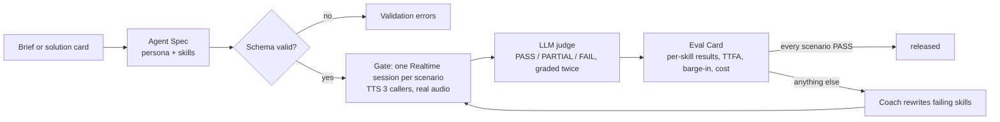

# Higgs Agent Factory

Anyone can build a voice agent in an afternoon. Nobody can tell you whether it's ready to talk to a customer.

Higgs Agent Factory turns a one-line brief, or one of the five solution cards on [boson.ai/solutions](https://www.boson.ai/solutions), into a voice agent on Boson's [Higgs Realtime API](https://docs.boson.ai/models/higgs-realtime/overview). Then it refuses to release that agent until the agent passes an eval gate. The gate plays scripted callers at the agent over real audio, has an LLM judge grade every answer against a rubric, measures latency and interruption handling client-side, and prints an **Eval Card**. If the agent fails, a coach rewrites only the skills that failed and the gate runs again.

Boson's homepage says "Agents that coach themselves." This repo is one way to make that claim measurable.


https://github.com/user-attachments/assets/6ff2ce2a-3144-46d4-b8c0-bf4f3052b3b7


Built in one day for the Boson AI hackathon in Toronto, 2026-10-24.

## What it does



- **Agent Spec.** A declarative agent: persona, voice, turn detection, budget limits, and a list of skills. Each skill has its own procedure, mocked tools and test scenarios, and each scenario has a pass / partial / fail rubric. Five templates ship, one per Boson solution card.
- **Eval gate.** Each scenario runs in its own Higgs Realtime session. Caller turns are synthesised once with Higgs TTS 3 and streamed in at real-time pace. A turn ends only after 2 s with no new response, so if server VAD splits a reply in two, it is still judged as one.
- **Judge.** Claude Sonnet grades each scenario twice from the transcript. If the two labels disagree, the scenario does not count as PASS, and the card shows the agreement rate.
- **Release rule.** Every scenario must PASS. A run cut short by quota, idle timeout or budget is `incomplete`, never `released`.
- **Eval Card.** Verdict, per-skill results, failing rubric lines with the judge's evidence, TTFA p50/p95, barge-in stop time, audio cost estimate, token counts, and how many responses each turn produced. Cards are diffable: `before → after` for a coach round.
- **Coach.** One model call per failing skill rewrites that skill's procedure, then the full gate runs again.
- **Demo page.** Pick a template or type a brief, inspect the spec, run a single scenario or the full gate, coach it, and talk to the agent live with your microphone. A Higgs Avatar view is available behind an opt-in toggle. An agent that has not passed the gate can still talk, but it carries a visible "not released" label.

## Demo video

The 2–3 minute walkthrough is not recorded yet; its link goes here once it is. Until then,
[Quick start](#quick-start) runs the demo page locally, and [`docs/DEMO-RUNBOOK.md`](docs/DEMO-RUNBOOK.md)
walks through what it shows.

## Results from live runs

Every number below comes from a stored Eval Card in [`docs/evidence/`](docs/evidence/) and has a row in [`docs/CLAIMS.md`](docs/CLAIMS.md) with its method and its caveats.

| What | Result | Evidence |
|---|---|---|
| Specialist Training, skills baseline (v1) | `rejected`, 4 of 6 scenarios PASS; refund-limits and scope-guard failed | run `20261024T174839Z-6f4ab3b5` |
| After one coach round (v2) | `released`, 6 of 6 PASS | run `20261024T180110Z-b501e4a3` |
| Judge self-agreement | 6 of 6 scenarios got the same label twice, in both runs | same runs |
| Time to first audio | p50 748 ms, p95 1,100 ms, n = 7 | run `20261024T171443Z-35b3f15b` |
| Barge-in stop time | 117 ms, n = 1 | same run |
| Cost of a six-scenario gate run | about $0.012 of audio, estimated from Boson's published per-minute rates | same run |

Read these the way the claim register does:

- **The coach saw the test.** The rewritten refund procedure quotes the scenario's own example. Going from 4/6 to 6/6 in one round shows the loop works end to end. It does not show the agent got better in general.
- **"Agreement" is one model agreeing with itself.** It is not agreement with a human or with a second model.
- **TTFA is measured on our side.** It runs from the last caller audio chunk sent to the first agent audio received, and it includes the server VAD silence window. Don't compare it with third-party benchmarks.

## What we found in Boson's API

Building on the public API turned up places where the docs and the wire disagree. We wrote them down for the Boson team, with evidence: one page in [`docs/BOSON-HANDOFF.md`](docs/BOSON-HANDOFF.md), the full log in [`docs/FRICTION.md`](docs/FRICTION.md), and every fact in [`docs/boson-protocol.md`](docs/boson-protocol.md) with its source and a `VERIFIED-DOCS` or `VERIFIED-RUN` tag. The main findings:

- **Token usage.** `response.done` is documented as `usage: null`, but it reports usage, in audio mode too (F2).
- **TTS `model` field.** TTS 3 rejects a request without `model`, which the docs call optional (F26).
- **Transcripts.** The assistant transcript arrives whole, ahead of the audio, so it never shows that an answer was cut off by an interruption (F27). Rubrics must not ask the judge to see that.
- **Turn splitting.** Server VAD appears to split one caller turn that has a pause into two responses. We saw it in a gate run, but it is not yet confirmed on the wire (it is in the UNVERIFIED list). Either way, it is why the gate has a quiet window.
- **Transport.** Realtime is WebSocket only, with no SIP or WebRTC, while two solution cards describe phone calls (F9).
- **Avatar plugin.** The LiveKit avatar plugin is pinned to a commit on a personal fork, not to a PyPI release (F11).

## Contribution to IHBench

[IHBench](https://github.com/boson-ai/ihbench) is Boson's interruption-recovery benchmark, and its OpenAI Realtime client cannot talk to Higgs Realtime. We wrote a Higgs Realtime client for it:
- a new client, a config, and one backend branch in the runner;
- 54 offline tests, green on websockets 12.0 and 17.3;
- a live 10-sample smoke run with 0 failures;
- a live check that the replayed history keeps its order.

The PR is [boson-ai/ihbench#2](https://github.com/boson-ai/ihbench/pull/2). Spec: [`specs/2026-10-24-ihbench-higgs-client.md`](specs/2026-10-24-ihbench-higgs-client.md).

## Quick start

```bash
uv sync
cp .env.example .env            # BOSON_API_KEY and ANTHROPIC_API_KEY
uv run pytest -m "not live"     # offline suite, spends nothing
set -a; source .env; set +a
```

| Command | What it does |
|---|---|
| `uv run python -m factory gate --template specialist-training` | Run the live gate and print and store an Eval Card |
| `uv run python -m factory gate --brief "…"` | Generate an agent from a brief (max 1,000 characters) and gate it |
| `uv run python -m factory coach --template specialist-training --fresh` | Gate, rewrite the failing skills, gate again |
| `uv run python -m factory diff specialist-training` | Diff the latest coached card against its parent |
| `uv run python -m factory serve --port 8000` | Demo page on http://127.0.0.1:8000 |

Live commands spend Boson and Anthropic credits: about a cent of Realtime audio per gate run, plus the judge calls. Use headphones for the live talk. To record the demo, follow [`docs/DEMO-RUNBOOK.md`](docs/DEMO-RUNBOOK.md).

## How it is built

The code follows ports and adapters. SDKs are imported only in adapters, and `factory/composition.py` is the only place that reads the environment.

| Path | Role |
|---|---|
| `factory/agent_spec/` | Agent Spec schema and validation, five templates, the brief → spec generator |
| `factory/runtime/boson_session.py` | Realtime session over [`pipecat-boson`](https://github.com/boson-ai/pipecat-boson), with a tap on the raw wire for timings and close codes |
| `factory/gate/` | Gate runner, audio playback, TTS cache, judge, verdict, metrics, cost, Eval Card build, store, render and diff |
| `factory/coach/` | Rewrites failing skills |
| `factory/live/`, `factory/web/` | Live session, avatar, and the FastAPI demo page |
| `factory/ports.py` | Ports and domain events; everything above depends on these, not on SDKs |

The process matters as much as the code. Every feature went spec → plan → test-first implementation → review → live run:
- **Specs** with EARS acceptance criteria: [`specs/`](specs/).
- **Plans** with their verification reports: [`docs/plans/`](docs/plans/).
- **Decisions** on libraries, vendors and fallbacks: [`docs/architecture-decisions/`](docs/architecture-decisions/).
- **Gate defects** found in live runs went back into the spec before the code changed. Example: a reply split by VAD leaked into the next scenario, so each scenario got its own session and turns got a quiet window.

Checks: `uv run pytest -m "not live"`, `uv run ruff check`, `uv run ruff format --check`, `uv run mypy`.

## Limitations

- **Templates.** Only Specialist Training has been gated live. The other four templates validate offline, but their rubrics have not had a human review.
- **Avatar and microphone.** The live demo page was tested with a scripted client. A real microphone and barge-in in the browser are checked by hand before a demo.
- **Coach.** The coach is one model and one round, and it can overfit to the visible scenario (see Results).
- **Token cost.** The card shows token counts but no token dollar figure yet.
- **Stability.** `judge reply invalid` appeared twice on one scenario early on and has not recurred. When it does, the raw judge reply is kept in the card for diagnosis.

## More

- [`STATUS.md`](STATUS.md): current state, with the command that proves each line.
- [`docs/BRIEF.md`](docs/BRIEF.md): goal, audience and the three-minute demo script.
- [`docs/reuse-map.md`](docs/reuse-map.md): which Boson pieces we reuse instead of rebuilding.
- [`CLAUDE.md`](CLAUDE.md): how to work in this repo.
