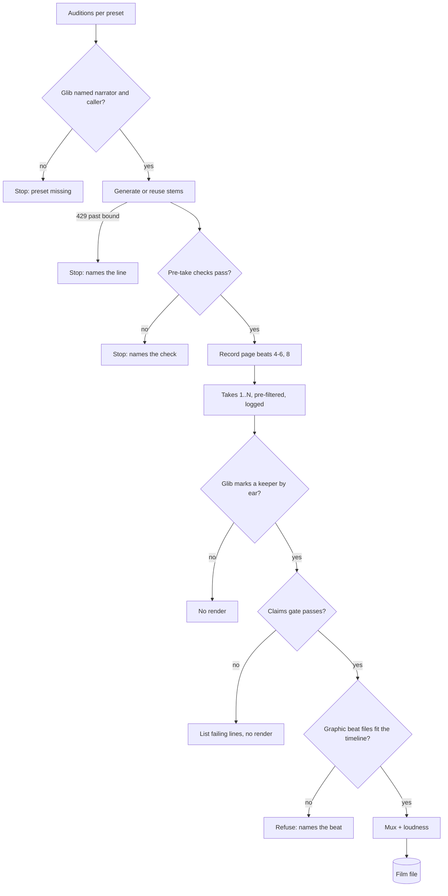
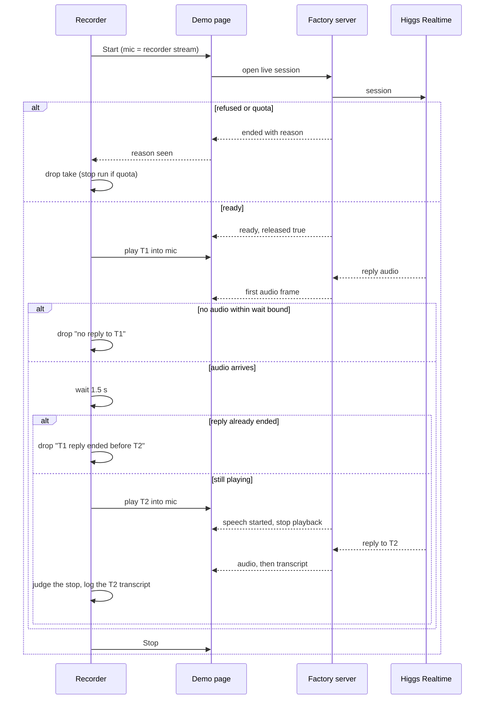
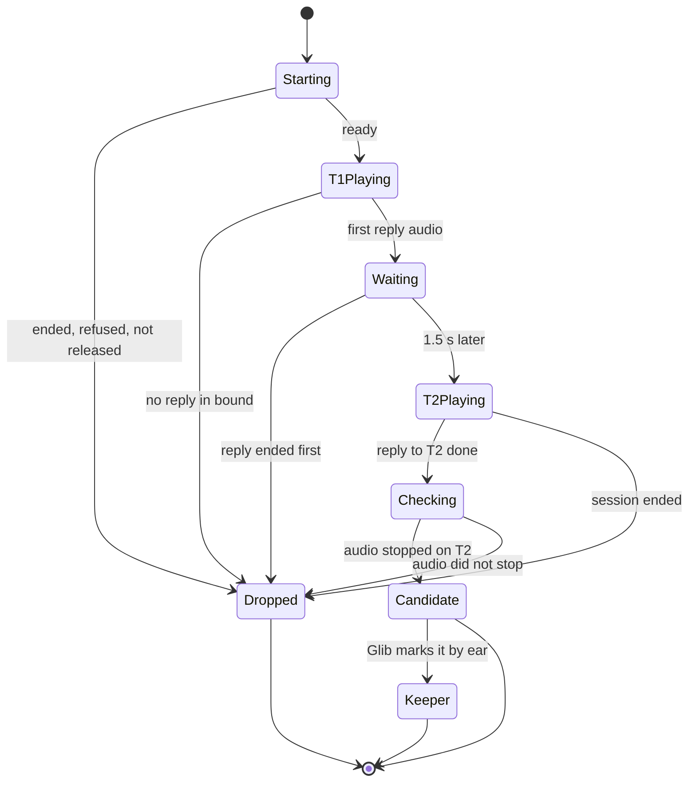

# Spec: Demo film recorder
Spec ID: SPEC-2026-10-24-demo-film
Status: approved
Tier: Full SDD — scorecard 5/6
Supersedes: none
Packages: factory (single-package repo; the recorder drives the existing demo page and reuses the TTS stem cache; no product behaviour changes)
Design sources: `docs/demo-film/screenplay.md` (v1, the approved storyline, beats, voice lines, beat 7 dialogue, end card, numbers-to-CLAIMS map, pre-take checks); Glib's decisions relayed in the brief of 2026-10-24 (no human, synthetic microphone, event-driven interruption, in-page audio capture, Higgs TTS 3 voices picked by ear, English, no avatar, 3–5 takes with a take log, separate graphic beats, claims gate)

Decisions referenced (Glib, 2026-10-24; the ADRs hold the how, this spec only the behaviour):
browser automation `docs/architecture-decisions/2026-10-24-python-playwright-for-demo-film.md`;
graphic beats `docs/architecture-decisions/2026-10-24-remotion-for-demo-film-graphics.md`. The
graphic beats are rendered by a separate, self-contained project (a Node/npm toolchain per that
ADR) into video files that the final mux places on the timeline. Its rendering is outside the
Python offline suite; what the suite proves is that the graphics read the same line data the
claims gate checks (AC-43) and that the rendered files fit the timeline (AC-60).

This spec implements the screenplay. It does not change the story, the voice lines or the
numbers. Where the screenplay and this spec disagree, the screenplay wins and this spec is
updated.

## Problem and user (L)(D)

Glib needs the 3-minute demo film (`docs/BRIEF.md`, Fallback; `STATUS.md`, Blocked) and does not
want a human at the keyboard. A hand-recorded take fails in known ways: on speakers the agent
hears itself, and macOS screen recording drops the agent's voice in headphones
(`docs/DEMO-RUNBOOK.md`). A hand-timed interruption lands at a different point of each reply.
The user of the tool is Glib (operator): he picks the voices by ear, reads the take log, picks the
take and approves the final render. The audience of the film is the Boson team.

## Outcome and metrics (D)

- One film file whose eight beats follow the screenplay, produced by a run nobody touches.
- At least one candidate take per run of 3–5 takes, where the agent's audio stops on T2, and
  one keeper that Glib marks by ear because its reply to T2 refuses and offers to go back to the
  policy (screenplay, Beat 7 dialogue).
- Zero numbers in the narration, graphics or end card without a CLAIMS row of status `ok`.
- Zero changes to stored Eval Cards and zero gate, coach or single-scenario runs caused by a
  film run.

## Goals / Non-goals (L)

Goals:
- Generate and cache every narrator and caller voice line with Higgs TTS 3 (F22), plus one-line
  audition clips so Glib can pick the narrator and caller presets by ear.
- Drive the demo page in Chromium with no human input and record the page beats (4–8).
- Record 3–5 live takes of beat 7 per run, with the caller lines fed in as the page's
  microphone and T2 triggered by the agent's first audio, and log why each take passed the
  audio-stop pre-filter or was dropped.
- Capture the take's audio as the page actually played it.
- Render the graphic beats (hook, market, decision, end card).
- Refuse the final render until the claims gate passes, then mux picture, take audio and
  narrator stems into one film.

Non-goals:
- Rewriting the screenplay, its voice lines or its numbers.
- Changing product behaviour: the demo page, the server, the live session, the Agent Spec or the
  stored cards. A page test hook is an open question, not a default.
- The avatar (F30): the **Avatar (optional)** box stays unticked.
- Running the gate, the coach, a single-scenario check or a brief proposal.
- Choosing the narrator or caller preset, or the final take, on Glib's behalf.
- Writing the market CLAIMS row (Glib's competitor table is not in the repo).
- Uploading or hosting the film (`STATUS.md`: hosted outside Git by Glib).
- Translation; the film is English only.
- Re-checking numbers the page itself shows on the Eval Card; they are the product's output and
  already have CLAIMS rows.

## User stories

- As Glib, I run auditions once and pick a narrator preset and a caller preset by ear, without
  paying for the same clip twice.
- As Glib, I start one run and walk away; when I come back there are 3–5 takes and a log that
  says which takes passed the audio-stop pre-filter, why the others did not, and what the agent
  said to T2.
- As Glib, I listen to the candidates, mark the keeper and get a film where the trainee cuts in mid-sentence and the
  agent stops, with no number on screen I cannot trace.
- As the implementer, I can prove the timeline math, the take rule, the claims gate and the stem
  cache offline, without spending credits.

## Acceptance criteria (EARS) (L)

### Run and safety

- AC-1 WHEN a film run is started, the system shall go from the first pre-take check to the last
  take with no keyboard, pointer or prompt input from a person. — proof: e2e — verify: (live)
  start a run with 3 takes on an unattended machine; expect the take log with 3 entries and no
  step waiting for input.
- AC-2 IF any pre-take check fails, THEN the system shall stop before opening any live session
  and name the failed check. The checks, from the screenplay's "Before the take": the
  Specialist Training latest card is `20261024T180110Z-b501e4a3`; the coach box shows v1
  `20261024T174839Z-6f4ab3b5` → v2 `20261024T180110Z-b501e4a3`; the brief agent
  `brief-onboarding-buddy-b948ed` shows v3 `20261024T183254Z-a5b00df6`; **Avatar (optional)** is
  unticked; every narrator, T1 and T2 stem is cached with its duration. — proof: red-first
  integration — verify: serve the page from a results folder whose latest Specialist Training
  card is v1; start a run; expect a stop that names the latest-card check and zero live sessions
  opened.
- AC-3 WHILE a run is in progress, the system shall send no request that starts a gate run, a
  coach run, a single-scenario check, a brief proposal, a proposal save or an avatar session. —
  proof: red-first integration — verify: run all page beats and one take against a server that
  counts requests per endpoint; expect zero on those six.
- AC-4 IF the page issues one of the requests in AC-3 during a run, THEN the system shall block
  that request, end the run and report which request was blocked. — proof: red-first
  integration — verify: during a run against a test server, trigger a click on **Run full gate**;
  expect the request never reaches the server and the run ends with "blocked: gate run".
- AC-5 WHEN a run ends, for any reason, the system shall leave every stored Eval Card and coach
  record byte-identical to its state at run start. — proof: red-first integration — verify: hash
  the stored cards before a run, run it to completion and again to an early stop; expect the same
  hashes both times.
- AC-6 The system shall record the film without any change to how the demo page or its server
  behave. — proof: red-first integration — verify: compare the page and server responses served
  with the recorder's branch against `main` at plan start; expect them identical.
  [NEEDS CLARIFICATION: Q-HOOK, only if the plan's spike finds the output tap impossible without
  a page hook]

### Voices and stems

- AC-7 The system shall produce every narrator and caller line with Higgs TTS 3 and a preset
  listed in F22. — proof: red-first unit — verify: build the stem list for the screenplay with a
  voice outside F22; expect a refusal naming the voice.
- AC-8 WHEN auditions are requested, the system shall produce one clip per narrator candidate
  (`eleanor`, `nora`, `oliver`, `marcus`, per the screenplay) and one clip per caller candidate
  (the six F22 presets), each named by its preset. Narrator candidates speak the beat 1 line;
  caller candidates speak T1 (default, Glib may change). — proof: red-first unit — verify: with a fake TTS, request auditions; expect
  4 narrator and 6 caller clips, named by preset.
- AC-9 IF the narrator preset or the caller preset has not been named by the operator, THEN the
  system shall refuse to generate stems and say which preset is missing. — proof: red-first
  unit — verify: request stems with only a narrator preset; expect a refusal naming the caller
  preset and zero TTS requests.
- AC-10 IF the operator names the same preset for narrator and caller, THEN the system shall
  refuse and ask for two different presets. — proof: red-first unit — verify: name `nora` for
  both; expect a refusal and zero TTS requests.
- AC-11 WHEN a stem is requested whose text, voice and TTS model match a cached stem, the system
  shall reuse the cached stem and send no TTS request. — proof: red-first unit — verify: request
  the same stem twice with a counting fake TTS; expect one request.
- AC-12 WHEN a stem is requested whose text, voice or TTS model differs from every cached stem,
  the system shall generate a new stem and keep the earlier one. — proof: red-first unit —
  verify: change one word of a line, then only the voice, then only the model; expect three new
  requests and the first stem still on disk.
- AC-13 WHEN a stem is cached, the system shall record its duration next to it. — proof:
  red-first unit — verify: cache a 2.0 s fake stem; expect a recorded duration of 2.0 s.
- AC-14 IF TTS answers 429 (F26), THEN the system shall retry at most 3 times, waiting 2 s, 4 s
  and 8 s (no wait longer than 8 s), and after the last refusal stop with a reason that names the
  line, without writing a partial stem: at most 4 requests in total (Glib, 2026-10-24). — proof: red-first unit — verify: a fake TTS that answers 429 forever and a fake clock;
  expect waits of 2, 4 and 8 s, then a stop naming the line and no stem on disk for it.
- AC-15 IF a T2 stem holds an internal silence at or above the server VAD silence window (F8),
  THEN the system shall refuse to use it in a take and name the gap. — proof: red-first unit —
  verify: a fake T2 stem with a 0.6 s silence after "Sorry, different question."; expect the
  refusal before any live session.

### Takes

- AC-16 WHEN a run is started, the system shall accept a take count from 3 to 5 and refuse any
  other count before opening a live session. — proof: red-first unit — verify: counts 2, 3, 5, 6;
  expect 2 and 6 refused.
- AC-62 WHILE a run is in progress, the system shall record exactly the requested number of
  takes, and not stop early at the first candidate; only AC-28 and AC-29 end a run sooner. —
  proof: red-first unit — verify: a 4-take run whose take 1 is a candidate; expect 4 log entries.
- AC-63 IF a run is started while another run is in progress, THEN the system shall refuse the
  second run before it opens any live session or writes to the take log. — proof: red-first
  integration — verify: start two runs together; expect the second refused and one take log.
- AC-17 WHILE a take runs, the system shall supply the page's microphone with a stream that
  carries only the caller stems the recorder plays and silence between them. — proof: e2e —
  verify: (live) run one take on a machine with no microphone attached; expect the page to reach
  "Live. Speak now." and the agent to answer T1.
- AC-18 WHEN the page reports the live session ready, the system shall play T1 into the
  microphone. — proof: red-first unit — verify: on a fake page timeline with ready at 3.0 s,
  expect T1 scheduled after 3.0 s and before any other caller audio.
- AC-19 WHEN the first assistant audio of the reply to T1 reaches the page, the system shall
  start T2 1.5 s later, whatever the reply's length. — proof: red-first unit — verify: fake
  timelines with first reply audio at 4.20 s and replies of 2 s and 8 s; expect T2 at 5.70 s in
  both.
- AC-20 IF the reply to T1 has finished playing before T2 is due, THEN the system shall mark the
  take dropped with reason "T1 reply ended before T2". — proof: red-first unit — verify: a fake
  reply whose last audio plays at 1.2 s after its first; expect that reason.
- AC-21 IF no assistant audio for the reply to T1 arrives within 10 s after T1 ends, THEN the system shall end the take and mark it dropped with reason "no
  reply to T1". — proof: red-first unit — verify: a fake timeline with no assistant audio; expect
  the take ended at the bound with that reason.
- AC-22 The system shall judge "audio stopped on T2" true only when the page signals the start
  of the trainee's speech while the T1 reply is still playing, and no audio of the T1 reply plays
  after that signal. — proof: red-first unit — verify: three fake timelines (stop on signal;
  T1-reply audio after the signal; signal after the reply ended); expect true, false, false.
- AC-23 WHEN a take ends, the system shall record the stop latency: from the start of T2 to the
  last audio of the T1 reply the page played. — proof: red-first unit — verify: T2 at 5.70 s,
  last T1-reply audio at 6.05 s; expect 350 ms.
- AC-24 IF more than one assistant response follows T2, THEN the system shall flag the take
  "T2 split into N responses" in the take log, for Glib's listen. — proof: red-first unit —
  verify: a fake timeline with two responses after T2; expect the flag with N = 2.
- AC-25 WHEN the reply to T2 completes, the system shall record its transcript in the take log
  and shall not judge its content; Glib judges by ear whether it refuses and offers to go back
  to the policy (Glib, 2026-10-24). — proof: red-first unit — verify: a fake take with a T2
  reply; expect the transcript in the log entry and no content verdict.
- AC-26 The system shall mark a take candidate only when AC-22 is true and no earlier drop
  reason applies, and otherwise mark it dropped with every failed condition named. — proof:
  red-first unit — verify: a stop-true take, a stop-false take, and a stop-true take that ended
  "limit reached"; expect candidate, dropped, dropped with their reasons.
- AC-59 WHEN Glib marks a take as the keeper, the system shall record the mark in the take log,
  and IF that take is not a candidate, THEN refuse the mark and name its drop reasons. — proof:
  red-first unit — verify: mark a candidate (recorded) and a dropped take (refused with reasons).
- AC-27 IF a take's live session ends before the reply to T2 completes, THEN the system shall
  mark the take dropped with the end reason the page received. — proof: red-first unit —
  verify: a fake timeline ending "limit reached" after T2; expect dropped, "limit reached".
- AC-28 IF a take ends with "quota refused" (F13), THEN the system shall start no further take
  in that run. — proof: red-first unit — verify: take 1 of 4 ends "quota refused"; expect one
  log entry and the run stopped with that reason.
- AC-29 IF the page shows the "not released" banner during a take, THEN the system shall end the
  take, mark it dropped "not released" and start no further take. — proof: red-first
  integration — verify: a test server whose ready message says `released: false`; expect that
  outcome and one live session.
- AC-30 WHEN a take ends, the system shall append one take log entry with: take number, start
  time, candidate or dropped, every reason, any "T2 split" flag, the actual T2 offset, the stop latency, the T2 reply
  transcript, the live TTFA values shown and the session end reason. — proof: red-first unit —
  verify: a fake take; expect one entry with every field filled or marked "none".
- AC-31 WHEN a take ends, the system shall hold one audio track with the caller lines as fed and
  the agent audio as the page played it, cut at barge-in. — proof: e2e — verify: (live) open a
  candidate take's audio; expect T1, the agent's reply silent within the logged stop latency after
  T2's start, T2, and the full reply to T2.
- AC-32 The system shall keep a take's audio and picture aligned within 100 ms. — proof: browser
  (main session) — verify: play the keeper take and check that the page's "Listening…" status
  and the agent's silence after T2 coincide within 100 ms.

### Timeline and picture

- AC-33 The film shall contain the screenplay's eight beats in its order, each with the picture
  source the screenplay gives it. — proof: browser (main session) — verify: watch the film
  against the screenplay's Beats table.
- AC-34 WHEN the timeline is computed, the system shall make each beat as long as its narrator
  line plus a 0.4 s lead and a 0.6 s tail. Beat 7 is narrator intro, then the take, then
  narrator outro. — proof: red-first unit — verify: stems of 10.0 s and 20.0 s; expect beats of
  11.0 s and 21.0 s.
- AC-35 The system shall never place a narrator stem over the take audio. — proof: red-first
  unit — verify: a computed timeline; expect no overlap between narrator intervals and the take
  interval.
- AC-36 WHEN the timeline is computed, the system shall report each beat's length against the
  screenplay's target and the total against 180 s. — proof: red-first unit — verify: a timeline
  with beat 5 at 49 s; expect "+4 s" on beat 5 and the total.
- AC-37 IF the total exceeds 180 s, THEN the system shall refuse the render and report the
  overrun per beat (180 s is a hard cap). — proof: red-first unit — verify: a 185 s timeline;
  expect a refusal; a 180.0 s timeline renders.
- AC-38 WHILE beat 5 plays, each highlight (v1 REJECTED 4/6 and the two failed skills, the
  rewritten procedures, v2 RELEASED 6/6 and both run ids) shall appear when the narrator sentence
  that names it starts, within ±0.5 s. — proof: red-first unit — verify: sentence start times
  from the stems; expect each highlight cue within 0.5 s of its sentence start.
- AC-39 WHILE beats 4–6 are recorded, the system shall open no live session. — proof: red-first
  integration — verify: count live sessions on a test server during beats 4–6; expect zero.
- AC-40 WHILE a caller line plays in beat 7, the system shall show its screenplay text as a
  caption for the line's duration. — proof: red-first unit — verify: T1 of 4.1 s starting at
  12.0 s; expect a caption from 12.0 s to 16.1 s with the exact T1 text.
- AC-41 WHEN the reply to T2 completes, the system shall caption it with the text the page
  received for that reply, shown as plain text. — proof: red-first unit — verify: a T2 reply
  transcript containing `<b>`; expect it shown literally.
- AC-55 WHILE the interrupted reply to T1 plays, the system shall caption it "(interrupted)" and
  never with text the agent did not speak (F27). — proof: red-first unit — verify: a fake take;
  expect "(interrupted)" for the T1 reply and no transcript text.
- AC-61 WHILE a narrator line plays in any beat, the system shall show its screenplay text as a
  caption for the line's duration. — proof: red-first unit — verify: the beat 1 stem starting at
  0.4 s; expect a caption with the exact beat 1 text for the stem's duration.
- AC-42 WHILE beat 7 plays, the live TTFA value and its label shall stay inside the frame. —
  proof: browser (main session) — verify: watch beat 7; the value and "speech_stopped to first
  audio delta" are visible throughout.
- AC-43 The graphic beats shall take their text only from the same line data the claims gate
  checks, and that text shall match the screenplay word for word, including `REJECTED · 4 / 6`,
  the run ids and the attribution of "Agents that coach themselves" to boson.ai. — proof:
  red-first unit — verify: read the shared line data for the hook, market, decision and end
  card; expect it equal to the screenplay text and every item covered by the claims gate.
- AC-60 IF a rendered graphic beat is missing, or its length differs from its timeline slot by
  more than one frame, THEN the system shall refuse the final render and name the beat. — proof:
  red-first integration — verify: remove the market beat's rendered file, then supply one 1 s
  short; expect two refusals naming the market beat.
- AC-44 WHILE the market beat plays, Boson's row shall light across speech-to-speech,
  text-to-speech and real-time avatar. — proof: browser (main session) — verify: watch beat 2.
- AC-56 WHILE the hook beat plays, the film shall carry one low tone under the narrator. —
  proof: browser (main session) — verify: listen to beat 1; one tone, no other sound effect.
- AC-45 WHEN beat 8 is recorded, the system shall show `boson-ai/ihbench` pull request 2, then
  the hand-off document, then the end card; the narration calls the PR "a draft pull request to
  Boson's repo" (screenplay, Glib 2026-10-24). Both the PR page and the hand-off document are
  shown from captured images, never from live GitHub during a run. — proof: browser (main session) — verify: watch beat 8.

### Claims gate and render

- AC-46 WHEN a final render is requested, the system shall run the claims gate first, and IF it
  fails, THEN render nothing and list every failing line. — proof: red-first integration —
  verify: request a render with the current CLAIMS register; expect no film and the market line
  listed.
- AC-47 The claims gate shall treat digits and English number words, including "a cent", as
  numbers, and fail every narrator, graphic or end-card line holding a number that maps to no
  CLAIMS row. — proof: red-first unit — verify: "four of six", "fifty euro", "about a cent",
  "k = 2" unmapped; expect four failures.
- AC-48 The claims gate shall pass a mapped row only when its status is `ok` or starts with `ok`
  followed by a note in parentheses. — proof: red-first unit — verify: rows with `ok`, `ok (no
  numbers)`, `measure`, `conversation-only`; expect pass, pass, fail, fail.
- AC-49 The claims gate shall pass a run id or agent id shown or spoken only when it appears in
  the evidence of its mapped CLAIMS row. — proof: red-first unit — verify: map v2
  `20261024T180110Z-b501e4a3` to the "Coach run" row (pass) and to the "Judge agreement rate" row
  (fail).
- AC-50 The claims gate shall fail the market line ("Of the companies we compared…") until a
  CLAIMS row for it exists with status `ok`. — proof: red-first unit — verify: the register as of
  this spec; expect a failure naming the market line.
- AC-51 WHEN the final render is requested, the system shall use the take Glib marked as the
  keeper, and IF no take carries the keeper mark, THEN refuse. — proof: red-first unit — verify:
  request a render with only candidate takes and no mark; expect a refusal.
- AC-52 WHEN the claims gate passes and a keeper is marked, the system shall produce one film
  file holding the picture of every beat, the keeper take's audio and the narrator stems at
  their timeline positions. — proof: e2e — verify: render with a marked keeper; expect one file
  whose length equals the computed timeline and whose beat 7 audio is the take's audio.
- AC-57 The film's mixed audio shall measure −16 LUFS integrated (Glib, 2026-10-24). — proof:
  red-first integration — verify: measure the integrated loudness of a rendered film; expect
  −16 LUFS.
- AC-58 The film shall be 1920×1080 at 30 fps (Glib, 2026-10-24), unless the pending capture
  research shows the page recording cannot reach it; then this AC is revisited with Glib, not
  lowered silently. — proof: red-first integration — verify: read the rendered film's resolution
  and frame rate; expect 1920×1080 and 30 fps.
- AC-53 The system shall keep every API key out of the take log, captions, stems, auditions and
  the film. — proof: red-first unit — verify: run the offline pipeline with a fake key value set;
  expect the value absent from every output.
- AC-54 The offline test suite shall prove the timeline math, the take rule, the claims gate and
  the stem cache with no network, and every check that opens a Boson session or calls TTS shall
  carry the `live` marker. — proof: red-first integration — verify: run `uv run pytest -m "not
  live"` with network access blocked; expect it green.

## Requirements coverage (L)

| R | requirement | source | AC |
|---|---|---|---|
| R-1 | No human: a script drives the demo page in Chromium | brief (Glib's decisions) | AC-1, AC-39 |
| R-2 | Caller lines pre-generated with Higgs TTS 3 and fed in as the page's microphone; no product change by default | brief | AC-6, AC-17, AC-18 |
| R-3 | T2 is triggered about 1.5 s after the first assistant audio of the reply to T1, not by a fixed timer | brief, screenplay Beat 7 | AC-19, AC-20, AC-21, AC-15 |
| R-4 | Take audio (caller plus agent as played) captured inside the page | brief | AC-31, AC-32 |
| R-5 | Picture, take audio and narrator stems muxed into the film | brief | AC-52, AC-35, AC-57, AC-58 |
| R-6 | All voices Higgs TTS 3 presets; narrator and caller picked by Glib from auditions; agent voice is the spec's `default` | brief, screenplay Voices | AC-7, AC-8, AC-9, AC-10, AC-6 |
| R-7 | Stems generated once and cached; 429 with no Retry-After (F26) | brief, screenplay | AC-11, AC-12, AC-13, AC-14 |
| R-8 | English; no avatar; Avatar box unticked | brief, screenplay | AC-2, AC-3, AC-43 |
| R-9 | 3–5 takes per run with a take log; the tool pre-filters on audio stopped on T2 and logs the T2 transcript; Glib judges the T2 reply by ear and marks the keeper | brief, screenplay Beat 7, Glib 2026-10-24 (Q2) | AC-16, AC-22, AC-23, AC-24, AC-25, AC-26, AC-27, AC-28, AC-29, AC-30, AC-59, AC-62, AC-63 |
| R-10 | Graphic beats (hook, market, decision, end card) rendered separately, to video files the mux places | brief, Glib 2026-10-24 (graphics ADR) | AC-43, AC-44, AC-56, AC-60 |
| R-11 | Claims gate before the final render; market line needs a new row from Glib | brief, screenplay Numbers and claims | AC-46, AC-47, AC-48, AC-49, AC-50 |
| R-12 | Live runs carry the `live` marker; offline tests for the pure parts | brief, CLAUDE.md | AC-54 |
| R-13 | Never press Run full gate, Coach failing skills or Run one scenario live during a take | brief, screenplay Before the take | AC-3, AC-4, AC-5 |
| R-14 | Pre-take checks from the screenplay | screenplay Before the take | AC-2 |
| R-15 | Beats in the screenplay's order, each held as long as its voice line | screenplay Beats | AC-33, AC-34, AC-36, AC-37, AC-38 |
| R-16 | Beat 7: captions on, live TTFA with label in frame, no "not released" banner | screenplay Beat 7 | AC-40, AC-41, AC-55, AC-61, AC-42, AC-29 |
| R-17 | Beat 8: the IHBench PR, the hand-off document, the end card | screenplay Beat 8 | AC-45, AC-43 |
| R-18 | Glib picks the final take | brief (take log), Glib 2026-10-24 (Q2) | AC-51, AC-59 |

## Edge cases (L)

- **Reply to T1 shorter than 1.5 s:** the reply ends before T2 is due; the take is dropped
  (AC-20). Persona answers are capped at two sentences (screenplay), so this is possible.
- **T2 split by server VAD:** a pause inside T2 can make two user turns and two responses
  (boson-protocol.md, UNVERIFIED list, seen in gate run `20261024T161045Z-d663176a`). Prevented
  at the stem (AC-15); handled at the take (AC-24).
- **Barge-in after the reply ended:** the page signals speech start, but nothing was playing;
  "audio stopped on T2" is false (AC-22).
- **The interrupted reply's transcript:** the page receives no transcript for a cancelled reply
  (the live session drops it), while F27 says a transcript can hold a whole sentence the audio
  never played. The take rule never reads text for the T1 reply; the stop is judged from audio
  and page signals only (AC-22).
- **Late audio of a cancelled reply:** the live session drops late deltas of a cancelled
  response; if any T1-reply audio still plays after the speech-start signal, the take fails AC-22.
- **Quota refused or concurrency limit mid-run (F13, F21):** the take is dropped with the page's
  reason; quota stops the run (AC-27, AC-28).
- **Live session limit or idle close (F8):** the take ends with the page's reason (AC-27).
- **Stored card changed by someone else between runs:** pre-take checks stop the run (AC-2).
- **Stem cache with a half-written file:** never read as a hit (existing cache behaviour).
- **TTS 429 storm while generating stems (F26):** at most 3 retries (2, 4, 8 s), then a named
  stop (AC-14).
- **No candidate after 5 takes, or Glib rejects every candidate by ear:** the run ends with the
  log; the render refuses until a keeper is marked (AC-51, AC-59). A new run is Glib's call.
- **Very long T2 reply:** the reply is shown in full; beat 7 grows and the total is reported
  against 180 s (AC-36, AC-37).
- **Two runs at once:** refused (AC-63); otherwise two live sessions could hit
  F21, and two writers can race the take log.
- **The page or server is not running when a run starts:** the first pre-take check fails and the
  run stops before any live session (AC-2).
- **GitHub unreachable during beat 8:** no effect; beat 8 uses captured images (AC-45).

## Non-functional requirements (L)

- Performance: none beyond existing for the product. The recorder's own timing thresholds are
  the T2 offset of 1.5 s (AC-19), the sync tolerance of 100 ms (AC-32), the cue tolerance of
  ±0.5 s (AC-38), the 10 s wait for the T1 reply (AC-21) and the 180 s hard cap (AC-37).
- Cost: TTS is paid once per distinct (text, voice, model) (AC-11); the full narration and both
  caller lines are a few thousand characters at the F12 TTS rate. Live: at most 5 live sessions
  per run (AC-16), each bounded by the agent's existing live-session limit; no gate, coach or
  judge run (AC-3); no model call per take (the T2 reply is judged by Glib, AC-25).
- Security and privacy: the API keys stay on the server side and out of every output (AC-53);
  the page is served on 127.0.0.1 only (existing); every untrusted input below is treated as data.
- Accessibility: every spoken line is captioned: narrator in all narrator beats (AC-61), caller
  and agent in beat 7 (AC-40, AC-41, AC-55).
- i18n: English only (non-goal).
- Reliability: TTS retry bounded (AC-14); a dropped take never ends the run except for quota
  refused or not released (AC-28, AC-29); a failed run never changes stored cards (AC-5); the
  render never runs on a failed claims gate (AC-46).

## Workflows and module communication

One run, end to end. Look at the two stops before any credits are spent: the presets and the
pre-take checks.

One take, and who talks to whom. The recorder only listens to the page's existing signals and
feeds the microphone; it never talks to Boson directly. The failure branches are what the take
log records.

A take's state, from the take log's point of view.

## Contracts

Reused, unchanged (the recorder only reads them):
- The live page's messages from its server: `ready` (with `released`, `verdict`, `run_id`,
  `limit_s`), `speech_started`, `clear`, `ttfa` (with `ms` and `label`), `transcript`, `ended`
  (with `reason`), and binary frames that are the assistant's audio (24 kHz s16le mono, F4).
- The page's visible states: the status line ("Live. Speak now.", "Listening…"), the "not
  released" banner, the TTFA list and label, the transcript box, **Start**, **Stop**,
  **Avatar (optional)**.
- The stored-card endpoints the page reads (latest card, coach box) for the pre-take checks.

New, owned by the recorder (behaviour-level shapes; the format is the plan's):
- **Stem record:** role (narrator, caller, audition), beat or line id, text, voice, TTS model,
  duration in seconds, and whether it was reused.
- **Take log entry:** the fields in AC-30. The take log is append-only within a run.
- **Claims map:** for each narrator line, graphic text and end-card item, the CLAIMS rows it
  relies on (the screenplay's "Numbers and claims" table as data). Each claims gate result
  names the line, the number or id found and why it failed.
- **Line data:** one shared source of the narrator lines, graphic texts and end-card items with
  their claims map and timeline slots. The claims gate checks it and the graphics renderer reads
  it, so a graphic cannot show text the gate never saw (AC-43).
- **Rendered graphic beats:** one video file per graphic beat, whose length matches its
  timeline slot (AC-60).
- **Keeper mark:** Glib's choice of one candidate take, recorded in the take log (AC-59).
- **Render request:** the narrator preset, the caller preset, the keeper take, and the gate
  result it ran on.

## Inputs and provenance (L)

- Screenplay text, beats, dialogue, end card, claims table [reused: `docs/demo-film/screenplay.md`]
- CLAIMS rows and statuses [reused: `docs/CLAIMS.md`]
- Narrator, caller and audition audio [new: Higgs TTS 3 calls, once per distinct text, voice and model; not LLM calls]
- Stem durations, timeline, captions timing, highlight cues [deterministic: recorder timeline]
- Take classification "audio stopped on T2" [deterministic: recorder, from page signals]
- Judgement "T2 reply refuses and offers to go back" [reused: Glib by ear, from the take audio and the logged transcript; no model call]
- Graphic beat video files [deterministic: the separate graphics project, from the shared line data]
- Agent replies, live TTFA, transcript [reused: the demo page's live session, live Higgs Realtime]
- Stored cards and coach box shown in beats 5–6 [reused: the page, from stored results]
- Market claim [NEEDS CLARIFICATION: Glib's competitor table, not in the repo, enters as a CLAIMS row]
- PR page and hand-off document for beat 8 [reused: github.com and `docs/BOSON-HANDOFF.md`]

## Untrusted inputs (L)

- **Agent speech and transcript (model output, live):** recorded as audio and logged as text;
  shown in captions as plain text, never as markup (AC-41); never decides what the recorder does
  next beyond the audio-stop pre-filter; it is never sent to a model.
- **TTS audio from the API:** checked for being non-empty, whole samples and the internal-silence
  rule (AC-15) before use; a failed response never leaves a partial stem.
- **The GitHub PR page:** third-party content shown in beat 8; nothing on it is read as an
  instruction or a claim; any number it shows is not part of the claims gate unless spoken or
  drawn by the film.
- **Glib's competitor table:** external; it enters the film only through a CLAIMS row that Glib
  writes (AC-50).
- **Page messages from the server:** the server is ours, but their text (`ended` message,
  transcript) is copied into the take log as data only.

## Open questions (L)(D)

Settled by Glib on 2026-10-24 and written into the ACs: Q1 retry bound (AC-14), Q2 judging by
ear (AC-25, AC-26, AC-59), browser and graphics ADRs (header), beat 8 wording (AC-45), loudness
(AC-57), resolution and frame rate (AC-58), audition lines (AC-8, default, Glib may change),
T2 split flagged for Glib's listen (AC-24, follows from Q2).

Approved by Glib with defaults on 2026-10-24: AC-14 (at most 4 requests), AC-21 (10 s), AC-32
(100 ms), AC-34 (0.4 s lead, 0.6 s tail), AC-37 (180 s hard cap), AC-38 (±0.5 s), AC-55
("(interrupted)"), AC-45 (captured images), AC-61 (narrator captions), AC-63 (two runs
refused), AC-62 (always the requested take count).

- [NEEDS CLARIFICATION: Q-HOOK — if the plan's spike cannot tap the page's audio output or microphone without a page change, may a small test hook be added to the page] — blocks AC-6 only in that case
- [NEEDS CLARIFICATION: research pending — can the page recording reach 1920×1080 at 30 fps] — non-blocking, AC-58
- [NEEDS CLARIFICATION: CLAIMS row for the market line, from Glib's competitor table of 2026-10-24] — blocks the final render (AC-50), not the plan

## Traceability (L)

| AC | proof | verify | step | test | commit |
|---|---|---|---|---|---|
| AC-1 | e2e | live run of 3 takes unattended; 3 log entries, no input | — | — | — |
| AC-2 | red-first integration | latest card v1; stop names the check; zero live sessions | — | — | — |
| AC-3 | red-first integration | per-endpoint counts on a test server; zero on the six | — | — | — |
| AC-4 | red-first integration | trigger Run full gate; blocked, run ends "blocked: gate run" | — | — | — |
| AC-5 | red-first integration | card hashes equal after a full and an early-stopped run | — | — | — |
| AC-6 | red-first integration | served page and server responses equal to main | — | — | — |
| AC-7 | red-first unit | voice outside F22 refused | — | — | — |
| AC-8 | red-first unit | 4 narrator and 6 caller clips, named by preset | — | — | — |
| AC-9 | red-first unit | caller preset missing; refusal, zero TTS requests | — | — | — |
| AC-10 | red-first unit | same preset twice; refusal | — | — | — |
| AC-11 | red-first unit | same stem twice; one TTS request | — | — | — |
| AC-12 | red-first unit | text, voice, model changes; three new stems, old kept | — | — | — |
| AC-13 | red-first unit | 2.0 s stem; duration 2.0 s recorded | — | — | — |
| AC-14 | red-first unit | endless 429, fake clock; waits 2, 4, 8 s, named stop, no stem | — | — | — |
| AC-15 | red-first unit | T2 stem with 0.6 s internal gap refused | — | — | — |
| AC-16 | red-first unit | counts 2 and 6 refused, 3 and 5 accepted | — | — | — |
| AC-17 | e2e | live take with no microphone attached reaches a reply | — | — | — |
| AC-18 | red-first unit | ready at 3.0 s; T1 after it, first | — | — | — |
| AC-19 | red-first unit | first reply audio 4.20 s; T2 at 5.70 s for 2 s and 8 s replies | — | — | — |
| AC-20 | red-first unit | reply ends 1.2 s after first audio; dropped with reason | — | — | — |
| AC-21 | red-first unit | no reply audio; ended at 10 s, "no reply to T1" | — | — | — |
| AC-22 | red-first unit | three timelines; true, false, false | — | — | — |
| AC-23 | red-first unit | T2 5.70 s, last audio 6.05 s; 350 ms | — | — | — |
| AC-24 | red-first unit | two responses after T2; flag "T2 split into 2 responses" | — | — | — |
| AC-25 | red-first unit | T2 transcript in the log, no content verdict | — | — | — |
| AC-26 | red-first unit | stop-true candidate; stop-false and limit-reached dropped | — | — | — |
| AC-27 | red-first unit | "limit reached" after T2; dropped with that reason | — | — | — |
| AC-28 | red-first unit | quota refused on take 1; run stops | — | — | — |
| AC-29 | red-first integration | ready with released false; take dropped, run stops | — | — | — |
| AC-30 | red-first unit | one entry, every field filled or "none" | — | — | — |
| AC-31 | e2e | live candidate take audio: T1, cut reply, T2, full reply | — | — | — |
| AC-32 | browser (main session) | "Listening…" and agent silence coincide within tolerance | — | — | — |
| AC-33 | browser (main session) | film against the screenplay's Beats table | — | — | — |
| AC-34 | red-first unit | 10 s and 20 s stems give 11 s and 21 s beats | — | — | — |
| AC-35 | red-first unit | no narrator interval overlaps the take | — | — | — |
| AC-36 | red-first unit | beat 5 at 49 s reported "+4 s", total reported | — | — | — |
| AC-37 | red-first unit | 185 s timeline refused; 180.0 s renders | — | — | — |
| AC-38 | red-first unit | each highlight cue at its sentence start | — | — | — |
| AC-39 | red-first integration | zero live sessions during beats 4–6 | — | — | — |
| AC-40 | red-first unit | T1 caption 12.0–16.1 s with exact text | — | — | — |
| AC-41 | red-first unit | transcript with `<b>` shown literally | — | — | — |
| AC-42 | browser (main session) | TTFA value and label visible through beat 7 | — | — | — |
| AC-43 | red-first unit | shared line data equals screenplay text, all of it gated | — | — | — |
| AC-44 | browser (main session) | Boson's row lights across the three columns | — | — | — |
| AC-45 | browser (main session) | PR, hand-off, end card in order | — | — | — |
| AC-46 | red-first integration | current register; no film, market line listed | — | — | — |
| AC-47 | red-first unit | four unmapped number phrases; four failures | — | — | — |
| AC-48 | red-first unit | ok, ok (…) pass; measure, conversation-only fail | — | — | — |
| AC-49 | red-first unit | v2 run id passes on Coach row, fails on Judge row | — | — | — |
| AC-50 | red-first unit | current register; market line fails | — | — | — |
| AC-51 | red-first unit | no keeper mark; render refused | — | — | — |
| AC-52 | e2e | one file, length equals timeline, beat 7 audio is the keeper take | — | — | — |
| AC-53 | red-first unit | fake key value absent from every output | — | — | — |
| AC-54 | red-first integration | offline suite green with network blocked | — | — | — |
| AC-55 | red-first unit | interrupted T1 reply captioned "(interrupted)", no transcript text | — | — | — |
| AC-56 | browser (main session) | one low tone in the hook | — | — | — |
| AC-57 | red-first integration | rendered film at −16 LUFS integrated | — | — | — |
| AC-58 | red-first integration | rendered film 1920×1080 at 30 fps | — | — | — |
| AC-59 | red-first unit | mark on a candidate recorded; on a dropped take refused | — | — | — |
| AC-60 | red-first integration | missing and 1 s-short market beat file; both refused | — | — | — |
| AC-61 | red-first unit | beat 1 narrator caption, exact text, stem duration | — | — | — |
| AC-62 | red-first unit | 4-take run with take 1 a candidate; 4 log entries | — | — | — |
| AC-63 | red-first integration | two runs together; second refused, one take log | — | — | — |

## Changelog (L)(D)

| date | change | why |
|---|---|---|
| 2026-10-24 | Created as draft (create mode, Full SDD 5/6) | Implements `docs/demo-film/screenplay.md` v1 with Glib's recording decisions; blocking questions Q1, Q2 and the dependency ADRs are open |
| 2026-10-24 | Answers folded in (answers mode): AC-14 retry bound 3 × (2, 4, 8 s); AC-24, AC-25, AC-26 rewritten for judging by ear, AC-59 keeper mark, AC-51 renders the keeper; AC-43 graphics read the claims-gated line data, AC-60 graphic files fit the timeline; ADRs for browser automation and graphics referenced; AC-45 beat 8 says "a draft pull request to Boson's repo"; AC-57 −16 LUFS; AC-58 1920×1080 at 30 fps; AC-8 audition lines as default | Glib's answers of 2026-10-24 to Q1, Q2, Q-ADR, beat 8 wording and the defaults |
| 2026-10-24 | Approved by Glib with defaults: AC-14 at most 4 requests (waits 2/4/8 s), AC-21 10 s, AC-32 100 ms, AC-34 0.4 s lead / 0.6 s tail, AC-37 180 s hard cap, AC-38 ±0.5 s, AC-55 "(interrupted)", AC-45 captured images; new AC-61 narrator captions, AC-62 always the requested take count, AC-63 two runs refused. Open: Q-HOOK, AC-58 research, AC-50 market row. The Status line was left `draft` because spec-creator never sets `approved`; Glib or the main session sets it on his word | Glib's approval relayed by the main session (answers mode) |
