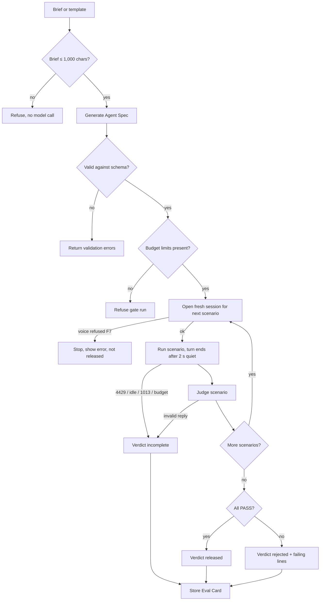
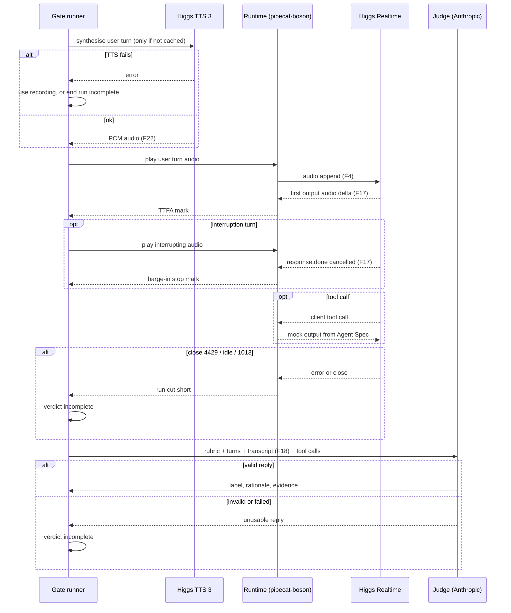
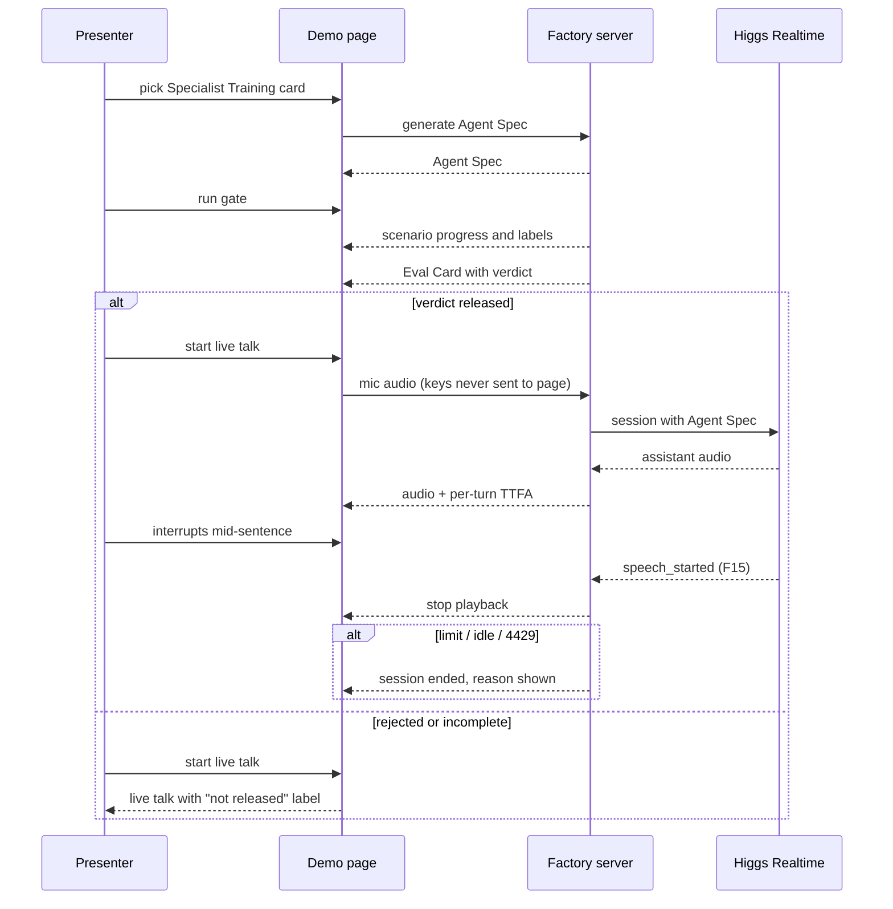
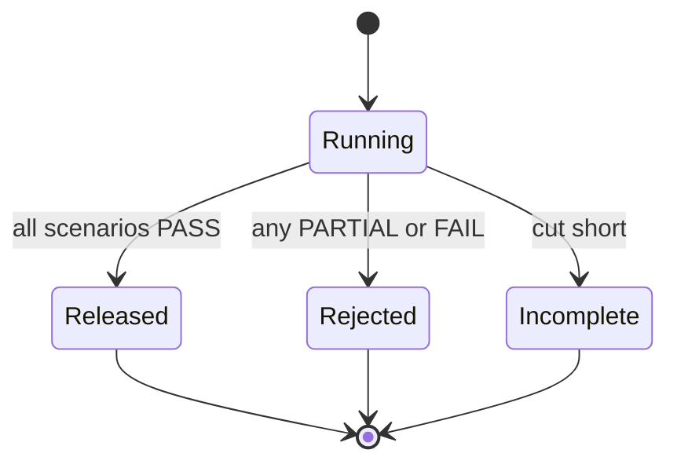

# Spec: Higgs Agent Factory
Spec ID: SPEC-2026-10-24-higgs-agent-factory
Status: approved
Tier: Full SDD — scorecard 6/6 (main session 6/6, re-scored by spec-creator 6/6)
Supersedes: none
Packages: root (single-package repo)
Design sources: user text, 2026-10-24 (task brief sections 0, 2, 3 relayed by the main session; Glib's answers to Q1–Q3 and the judge-vendor decision); `docs/BRIEF.md`; `docs/reuse-map.md`; `docs/CLAIMS.md`; `docs/boson-protocol.md` (F1–F22); live smoke `results/smoke-20261024T145225Z.jsonl`; reference code in `vendor-ref/` (read-only)

Boson API behaviour is cited by fact id from `docs/boson-protocol.md` and never restated here.
Anything not in that file is UNVERIFIED.

## Problem and user

Anyone can stand up a voice agent on Higgs Realtime in an afternoon. Nobody can say whether it
is ready to talk to a customer. Boson's own pitch is "Agents that coach themselves"
(`docs/CLAIMS.md`), and agentic tasks are where Higgs Realtime measures weakest independently
(τ-Voice row in `docs/CLAIMS.md`, conversation only).

Users:
- **Builder** (Glib on stage, later any Higgs developer): describes an agent in one line or picks
  one of the five solution cards on boson.ai/solutions, and wants a yes/no on release with the
  evidence behind it.
- **Audience** (the Boson AI team at the MScAC Higgs Audio hackathon): judges the harness by
  whether every number on screen is real and traceable.

## Outcome and metrics

Outcome: a brief becomes an agent on Higgs Realtime that is released only after it passes an eval
gate, and the result is an Eval Card with measured numbers.

| metric | target | how measured |
|---|---|---|
| P1 done | one Eval Card from a real gate run on the Specialist Training agent | AC-45 |
| Traceability | 100% of numbers on the stage card trace to a stored run or a cited source | AC-33, `docs/CLAIMS.md` row per number |
| Honest cost | 0 cost figures presented as billed cost | AC-31, AC-32 |
| Gate integrity | 0 agents `released` with a non-PASS scenario or from a cut-short run | AC-12, AC-13, AC-14…AC-18 |
| Engagement | at least one Boson engineer asks about the gate, the PR or the friction log | observed on site (`docs/BRIEF.md`) |

## Goals / Non-goals

Goals, in priority order (`docs/BRIEF.md`):
- P0 is Spec B (`specs/2026-10-24-ihbench-higgs-client.md`). This spec depends on it only for the
  IHBench RQ field of the Eval Card.
- P1: Agent Spec contract and schema, generator (brief or template → Agent Spec), eval gate
  (scripted scenarios, judge, verdict), Eval Card, proven end to end on the Specialist Training
  template.
- P2: one demo page that runs demo steps 2 and 3 (template → Agent Spec → gate → Eval Card, then a
  live conversation with a deliberate interruption).
- Reuse Boson's public pieces per `docs/reuse-map.md`; the differentiator is the gate.

Non-goals:
- Telephony, SIP, WebRTC (F9).
- Production auth, multi-user, more than one live session at a time.
- Our own speech-to-speech stack, Realtime client, tool dispatch or barge-in handling (the
  runtime is `pipecat-boson`, `docs/reuse-map.md`).
- Any cost figure presented as billed or invoiced cost; any token-cost figure for a run in which some response reported no usage (F2).
- Gating release on IHBench RQ, TTFA or barge-in stop time (Glib, Q1: informational only).
- Input audio transcription (F19, billed); scripted user turn texts are already known.
- Marketing claims built on Boson's self-authored benchmarks, or comparing our numbers to them.
- P3 live avatar acceptance. Lane L5 is a hint only; its acceptance criteria are added to this
  spec by a later Changelog row if P2 is finished (F11).
- Real tool side effects: client tools are always mocked.
- Competing with Feynman Flow; the harness is a community layer on the public API.

## User stories

- As a builder, I pick the Specialist Training card and get a valid Agent Spec I can read.
- As a builder, I type a one-line brief and get either a valid Agent Spec or the list of what is
  wrong with it.
- As a builder, I run the gate and see each scenario judged, with the failing rubric lines when
  it fails.
- As a builder, I get an Eval Card whose every number I can trace to a run.
- As a presenter, I talk to a released agent live, interrupt it, and see per-turn TTFA.
- As a Boson engineer, I can see whether the token cost was measured from reported usage, why it is absent when it was not, and that the audio cost is an estimate.

## Acceptance criteria (EARS)

Proof tags: `red-first unit | red-first integration | e2e | browser (main session)`. `e2e` here
means a run against the live Boson API (the `live` marker, spends credits).

### Brief, templates and schema (L1)
- AC-1 WHEN a free-text brief of at most 1,000 characters is submitted, the system shall return either an Agent Spec that validates against the Agent Spec schema or the list of validation errors, each naming the failing field. — proof: red-first unit — verify: feed the generator step one canned valid output and one canned output missing `voice`; expect a valid spec for the first and an error naming `voice` for the second
- AC-2 IF a submitted brief exceeds 1,000 characters, THEN the system shall refuse it with a message that states the limit and shall make no model call. — proof: red-first unit — verify: submit 1,001 characters with a generator double that counts calls; expect the refusal message and 0 calls
- AC-3 WHEN the user selects one of the five solution templates (Health Insurance, Fraud Detection, Customer Support, AI Receptionist, Specialist Training), the system shall produce an Agent Spec whose source field names that template and which validates against the schema. — proof: red-first unit — verify: select each of the five templates in turn; expect five valid specs, each with its template id as source
- AC-4 IF an Agent Spec has no budget limits, THEN the system shall refuse to start a gate run and name the missing limit fields. — proof: red-first unit — verify: remove the budget block from a valid spec, start the gate; expect refusal naming the budget fields and no Boson session opened
- AC-5 WHEN the Specialist Training template is selected, the system shall set its budget limits to exactly: 6 scenarios, 4 minutes of total audio (input plus output) per gate run, 1 judge call per scenario, and 3 minutes per live session. — proof: red-first unit — verify: generate from the Specialist Training template; expect those four values in the budget block
- AC-46 IF an Agent Spec has more scenarios than its own max-scenarios limit, THEN the system shall refuse to start a gate run and state both numbers. — proof: red-first unit — verify: a spec with limit 6 and 7 scenarios; expect refusal naming 7 and 6 and no Boson session opened
- AC-6 IF an Agent Spec's turn-detection settings contain `idle_timeout_ms` (rejected per F8), THEN schema validation shall fail and name that field. — proof: red-first unit — verify: add `idle_timeout_ms` to a valid spec; expect a validation error naming it
- AC-7 IF a client function tool in an Agent Spec has no mock behaviour, THEN schema validation shall fail and name that tool. — proof: red-first unit — verify: delete the mock of one tool in a valid spec; expect an error naming the tool

### Gate run (L2, L3)
- AC-8 WHEN a gate run needs audio for a scripted user turn, the system shall synthesise it with Higgs TTS 3 (F22) at most once per distinct text and voice and reuse the stored audio on later runs. — proof: red-first integration — verify: run the same scenario twice with a TTS double that counts requests; expect one request per distinct turn across both runs
- AC-9 IF TTS 3 synthesis fails for a user turn and a recorded audio file is supplied for that turn, THEN the system shall play the recording and mark that scenario's audio source as "recorded" on the Eval Card. — proof: red-first integration — verify: make the TTS double return an error for one turn that has a recording; expect the run to continue and the card to show "recorded" for that scenario
- AC-10 IF a scripted user turn has neither synthesised nor recorded audio, THEN the system shall end the gate run with verdict `incomplete` and name the turn. — proof: red-first integration — verify: TTS double fails and no recording exists; expect verdict `incomplete` naming the turn and no `released`
- AC-11 WHEN a scenario ends, the system shall send the judge exactly one request with the scenario's rubric, the scripted user turn texts, the assistant transcript (F18) and the observed tool calls, and record the returned label (PASS, PARTIAL or FAIL), rationale and evidence quote. — proof: red-first unit — verify: end a scenario with a judge double; expect one request containing all four inputs and the three returned fields stored for that scenario
- AC-12 IF any scenario in a gate run is labelled PARTIAL or FAIL, THEN the system shall set the verdict to `rejected` and show, for each such scenario, its label, the rubric criteria it was judged against, the judge's rationale and the evidence quote. — proof: red-first unit — verify: judge double returns PASS, PARTIAL, PASS; expect `rejected` and the PARTIAL scenario's criteria, rationale and evidence on the card
- AC-13 WHEN every scenario of a gate run that ran to the end is labelled PASS, the system shall set the verdict to `released`. — proof: red-first unit — verify: judge double returns PASS for all scenarios; expect `released`
- AC-14 IF the Boson session closes with code 4429 after an `insufficient_quota` error (F13) during a gate run, THEN the system shall set the verdict to `incomplete` with cause "quota refused" and shall not set `released`. — proof: red-first integration — verify: fake Realtime server sends the F13 error and closes with 4429 mid-scenario; expect `incomplete`, cause "quota refused"
- AC-15 IF the server sends `session.idle_timeout` (F8) during a gate run, THEN the system shall set the verdict to `incomplete` with cause "idle timeout". — proof: red-first integration — verify: fake server sends `session.idle_timeout` and closes; expect `incomplete`, cause "idle timeout"
- AC-16 IF the Boson session closes with code 1013 (F21) during a gate run, THEN the system shall set the verdict to `incomplete` with cause "concurrency limit". — proof: red-first integration — verify: fake server closes with 1013; expect `incomplete`, cause "concurrency limit"
- AC-55 WHEN a gate run starts a scenario, the system shall open a new Realtime session for that scenario alone, so that no other scenario's history, events, transcript or audio reaches it. — proof: red-first integration — verify: run three scenarios against a fake server that logs sessions; expect three sessions, each receiving only its own scenario's turns, and each judge request containing only its own scenario's transcript
- AC-56 The system shall sum the measured audio of all scenario sessions of a gate run against the per-run audio limit. — proof: red-first integration — verify: per-run limit 10 s, three scenarios of about 4 s audio each; expect the run to stop during the third scenario with `incomplete`, cause "budget reached"
- AC-57 WHEN a response of a user turn ends (`response.done`, F17), the system shall treat the turn's reply as finished only after 2 s pass with no new response started. — proof: red-first integration — verify: fake server ends response A, starts response B 1.2 s later and ends it; expect the next scripted turn to start no earlier than 2 s after B's `response.done`, and not after A's
- AC-58 WHEN more than one response starts within a user turn's quiet window, the system shall join their transcripts in order as that turn's reply and send all of them to the judge. — proof: red-first integration — verify: replay the st-5 split ("No problem." then the real answer 1 s later); expect the judge request for st-5 to hold both texts in order, and neither text in any other scenario's judge request
- AC-59 The system shall measure a user turn's TTFA on the first response of that turn only. — proof: red-first unit — verify: a turn with two responses whose first audio deltas arrive at 400 ms and 1,600 ms; expect one TTFA record of 400 ms for that turn
- AC-60 The system shall count streamed silence sent during a turn's quiet window toward the per-run audio limit. — proof: red-first integration — verify: a turn followed by a 2 s quiet window; expect the run's input audio minutes to include the 2 s of silence
- AC-61 WHEN a user turn ends, the system shall record in the run record and on the Eval Card how many responses the turn produced. — proof: red-first unit — verify: a run with one split turn and one normal turn; expect counts 2 and 1 stored and shown for those turns
- AC-17 IF the measured audio of a gate run (input plus output) reaches the Agent Spec's per-run audio limit before the last scenario ends, THEN the system shall stop the run and set the verdict to `incomplete` with cause "budget reached". — proof: red-first integration — verify: set the audio limit below one scenario's length; expect the run to stop at the limit with `incomplete`, cause "budget reached"
- AC-18 IF the judge's reply does not carry exactly one of the labels PASS, PARTIAL or FAIL plus a rationale and an evidence quote, THEN the system shall set the verdict to `incomplete` with cause "judge reply invalid" and make no further judge call for that scenario. — proof: red-first unit — verify: judge double returns `{"label": "MAYBE"}`; expect `incomplete`, one judge call in total for that scenario
- AC-62 WHEN a scenario's judge reply is invalid (AC-18), the system shall keep, for that scenario, in both the run record and the stored Eval Card, the judge's raw reply text (at most its first 2,000 characters) and the character length of the transcript the judge received. — proof: red-first unit — verify: judge double returns `{"label": "MAYBE"}` for a scenario whose transcript is 412 characters; expect the raw text `{"label": "MAYBE"}` and length 412 in both the run record and the stored card
- AC-63 IF an invalid judge reply is longer than 2,000 characters, THEN the system shall keep only its first 2,000 characters and mark the kept text as truncated. — proof: red-first unit — verify: judge double returns 5,000 characters of invalid text; expect exactly the first 2,000 characters kept and a truncated flag set
- AC-64 WHEN an Eval Card with an invalid judge reply is shown, the system shall show for that scenario the cause, the transcript length and a note that the raw reply was kept, and shall not show the raw reply text or present any part of it as rationale or evidence. — proof: red-first unit — verify: render a card whose raw reply contains "PASS" and markup; expect cause, length and the note, and neither the reply text nor its markup in the rendered card
- AC-19 The system shall decide the verdict from scenario labels and run completion only, so IHBench RQ, TTFA and barge-in stop time never change it. — proof: red-first unit — verify: same PASS labels with RQ 0% and TTFA p95 of 30 s; expect `released`
- AC-20 IF the session configuration with the Agent Spec's voice is refused by the server (F7, F14), THEN the system shall stop before any scenario runs, show the server's error text, and shall not set `released`. [NEEDS CLARIFICATION: is this verdict labelled `rejected` (agent fault) or `incomplete`?] — proof: red-first integration — verify: fake server answers the first session update with an `error` and closes; expect no scenario started, the error text shown, verdict not `released`
- AC-21 WHEN the model emits a `web_search` call with `executor: "server"` (F10), the system shall send no tool output and no response request for it, and shall record it as an observed tool call marked "server". — proof: red-first integration — verify: fake server emits a server `web_search` call item; expect no client reply event and the call listed as "server" on the scenario record
- AC-22 WHEN the model calls a client function tool, the system shall answer with the mock output defined in the Agent Spec for that tool and perform no other action. — proof: red-first integration — verify: fake server emits a client tool call; expect the spec's mock output sent back and no other outgoing request
- AC-23 WHEN a scenario that declares an expected tool call ends, the system shall record on the Eval Card whether a call with that tool name and the declared required arguments was observed. [NEEDS CLARIFICATION: does a missing expected call force the scenario below PASS regardless of the judge?] — proof: red-first unit — verify: one scenario with the expected call observed, one without; expect "matched" and "not matched"
- AC-24 WHEN the server sends an event type the system does not know (F5), the system shall ignore it and continue the run. — proof: red-first unit — verify: inject an unknown event type mid-scenario; expect the scenario to complete normally

### Measurements (L3)
- AC-47 WHEN a scripted user turn is played, the system shall stream its audio at real-time pace (each second of audio sent over about one second) and follow it with streamed silence, never sending a turn in one burst. — proof: red-first integration — verify: play a 3 s turn to a fake server that timestamps appends; expect speech appends spread over 3 s ± 0.3 s, followed by silence appends
- AC-25 WHEN the last speech chunk (before the trailing silence) of a scripted user turn has been sent, the system shall record that turn's TTFA as the client-side time until the first `response.output_audio.delta` (F17) of the response that follows. — proof: red-first integration — verify: fake server delays its first audio delta by 400 ms after the last chunk; expect a recorded TTFA of 400 ms ± 50 ms
- AC-26 WHILE a live session runs, the system shall record TTFA for every user turn, from the client's receipt of `input_audio_buffer.speech_stopped` (F15) to the first `response.output_audio.delta` (F17) of the response that follows. [NEEDS CLARIFICATION: live start point. `speech_stopped` receipt excludes the VAD silence window that the card's TTFA includes (AC-27), so live numbers will read lower than the card's; alternative is a client-side end-of-speech mark.] — proof: red-first integration — verify: fake server sends `speech_stopped` and then an audio delta 300 ms later, three times; expect three TTFA records of about 300 ms
- AC-27 WHEN an Eval Card is produced, the system shall show TTFA p50 and p95 over all scripted turns of the run, the number of turns n, and a label stating that timing starts at the last user speech chunk sent and so includes the server VAD silence window (F8). — proof: red-first unit — verify: feed 20 known TTFA values; expect the correct p50, p95, n = 20 and the label text
- AC-48 The system shall compute the Eval Card's TTFA p50 and p95 from scripted gate-run turns only, never from live-session turns. — proof: red-first unit — verify: store a run with 10 scripted and 5 live TTFA values; expect n = 10 and percentiles from the scripted values only
- AC-28 WHEN an interrupting user turn is played over assistant audio, the system shall record barge-in stop time from the client sending the first interrupting audio chunk to the receipt of the last `response.output_audio.delta` carrying the interrupted response's id before its `response.done` (F17). — proof: red-first integration — verify: fake server keeps sending deltas for 250 ms after interruption audio starts, then sends `response.done` cancelled; expect about 250 ms
- AC-29 IF the interrupted response's `response.done` has status `completed`, or no `response.done` for it arrives before the scenario ends, or its last audio delta arrived before the interrupting audio started, THEN the system shall record that turn's barge-in stop time as "not measured" and leave it out of the card's aggregate. — proof: red-first unit — verify: one interruption ends `completed`, one has no `response.done`, one whose last delta precedes the interruption; expect all three "not measured" and the aggregate computed from the rest
- AC-54 WHEN an Eval Card is produced, the system shall show barge-in stop time as p50 and max over the measured interruptions, together with their count N, excluding "not measured" turns. — proof: red-first unit — verify: feed measured values 200, 300, 900 ms plus one "not measured"; expect p50 300 ms, max 900 ms, N = 3

### Cost (L3)
- AC-30 WHEN an Eval Card is produced, the system shall show the estimated audio cost as measured input audio minutes times the F12 audio-input rate plus measured output audio minutes times the F12 audio-output rate, with both minute counts shown and the label "estimated from Boson's published per-minute rates". — proof: red-first unit — verify: 2.0 input minutes and 1.5 output minutes; expect 2.0 × the F12 audio-input rate + 1.5 × the F12 audio-output rate, and the label
- AC-31 IF any `response.done` of a run carries no usage (F2), THEN the system shall show the token part of the cost as "Billed token cost: not measurable, the API returns no usage (F2)", the phrasing in `docs/CLAIMS.md`, and shall show no figure that includes token cost. — proof: red-first unit — verify: produce a card from a run where two responses report usage and one has `usage: null`; expect that exact text and no token amount anywhere on the card
- AC-50 WHEN every `response.done` of a run reported usage (F2), the system shall show the measured token cost as the run's non-cached input tokens × the F12 input-token rate + cached input tokens × the F12 cached-input rate + output tokens × the F12 output-token rate, with the three token counts and the label "measured from reported usage × Boson's published token rates". [NEEDS CLARIFICATION: whether `input_tokens` already includes `cached_tokens` (the smoke run had 0 cached), which decides the non-cached count; settle with a run that has cache hits.] — proof: red-first unit — verify: a run whose responses report 1,000 input (200 cached) and 300 output tokens in total; expect the formula applied to those counts, the three counts and the label
- AC-51 WHEN a measured token cost is shown (AC-50), the system shall show it as the card's headline cost and still show the estimated audio cost (AC-30) as a separate line labelled as an estimate. — proof: red-first unit — verify: render a card from a run with usage on every response; expect the token cost in the headline cost position and the audio estimate on its own labelled line
- AC-32 The system shall not label any numeric cost figure as billed, actual or invoiced cost. — proof: red-first unit — verify: render a card and the demo page cost block; expect no dollar amount labelled "billed", "actual" or "invoiced" (the AC-31 text, which carries no amount, is allowed)

### Eval Card (L3)
- AC-33 WHEN a gate run ends with any verdict, the system shall store an Eval Card with every Eval Card field and the run's raw per-turn measurements under the run id, without overwriting an earlier card. — proof: red-first unit — verify: end two runs for the same agent; expect two stored cards with distinct run ids, each with its per-turn TTFA, barge-in and audio-minute records
- AC-34 WHERE an IHBench result for Higgs Realtime from Spec B is available, the system shall show its RQ pass rate labelled "model-level, IHBench samples" together with that result's source and date; otherwise it shall show "not available". — proof: red-first unit — verify: build one card with a sample IHBench judge output and one without; expect the labelled rate with source and date, and "not available"

### Live session and demo page (L2, L4)
- AC-35 WHEN a live session reaches the Agent Spec's live-session limit, the system shall close the session and tell the user the limit was reached. — proof: red-first integration — verify: set the limit to 5 s against a fake server; expect the session closed at about 5 s and the limit message
- AC-36 WHILE a live session runs for an agent whose latest Eval Card verdict is not `released`, the demo page shall show a visible "not released" label for the whole session. — proof: browser (main session) — verify: start a live session for an agent whose latest card is `rejected`; expect the session to start and the "not released" label visible until it ends
- AC-52 WHEN the demo page reaches the gate step, the system shall show the stored full Eval Card of the agent's latest complete gate run, with its run id and timestamp. — proof: browser (main session) — verify: with a stored card for Specialist Training, open the gate step; expect that card with its run id and timestamp
- AC-53 WHEN the presenter runs one chosen scenario live from the demo page, the system shall show that scenario's label, rationale, evidence and TTFA, mark the result "single-scenario check", and leave the agent's verdict from its full gate run unchanged. — proof: red-first integration — verify: with a stored `rejected` card, run one scenario that the judge double labels PASS; expect the scenario result shown as "single-scenario check" and the stored verdict still `rejected`
- AC-37 The system shall never send a Boson or Anthropic API key to the demo page. — proof: red-first integration — verify: load every page response and live-session message with test keys set; expect neither key string in any of them
- AC-38 WHEN the demo page opens, the system shall show the five template cards. — proof: browser (main session) — verify: open the page; expect five cards with their names
- AC-49 WHEN the user selects a template card on the demo page, the system shall show the Agent Spec generated from it. — proof: browser (main session) — verify: click Specialist Training; expect its Agent Spec displayed
- AC-39 WHILE a gate run is in progress, the demo page shall show which scenario is running and each finished scenario's label. — proof: browser (main session) — verify: start the gate; expect the running scenario named and labels appearing one by one
- AC-40 WHEN a gate run ends, the demo page shall show the Eval Card with the verdict written as a word, not by colour alone. — proof: browser (main session) — verify: finish a run; expect the card and the verdict word visible
- AC-41 WHILE a live session runs, the demo page shall show each turn's TTFA as it is recorded, with a label naming where the live timing starts. — proof: browser (main session) — verify: hold a three-turn conversation; expect three TTFA values and the start-point label on the page
- AC-42 WHEN `input_audio_buffer.speech_started` (F15) arrives while assistant audio is playing in a live session, the demo page shall stop playing that response's audio. — proof: browser (main session) — verify: talk over the agent mid-sentence; expect its audio to stop
- AC-43 WHEN `session.idle_timeout` (F8) arrives in a live session, the demo page shall say the session ended for inactivity and offer to start a new one. — proof: red-first integration — verify: fake server sends `session.idle_timeout`; expect the inactivity message and a start control
- AC-44 IF a live session closes with code 4429 (F13), THEN the demo page shall say the API quota was refused and shall not reconnect on its own. — proof: red-first integration — verify: fake server closes with 4429; expect the quota message and no new connection attempt

### End to end (P1 done)
- AC-45 WHEN the gate runs on the Specialist Training agent against the live Boson API, the system shall produce a stored Eval Card with a verdict, TTFA p50/p95 with n ≥ 1, input and output audio minutes and the estimated audio cost. — proof: e2e — verify: with `BOSON_API_KEY` and `ANTHROPIC_API_KEY` set, run the gate on Specialist Training; expect a stored card with those fields filled from the run

## Requirements coverage

| R | requirement | source | AC |
|---|---|---|---|
| R-1 | Brief → Agent Spec that validates, or validation errors | brief (main session) | AC-1, AC-6, AC-7 |
| R-2 | Brief text bounded at 1,000 characters | Glib, Q3 | AC-2 |
| R-3 | Selecting one of the 5 templates generates the Agent Spec from it | brief | AC-3 |
| R-4 | Budget limits are a required Agent Spec field; gate refuses without them | Glib, Q3 | AC-4 |
| R-5 | Specialist Training defaults: 6 scenarios, 4 min audio, 1 judge call per scenario, 3 min live | Glib, Q3 | AC-5, AC-46, AC-17, AC-35 |
| R-6 | Agent Spec contract (id, source, role, instructions, voice, tools with mock, turn detection, scenarios with rubric, budget) | brief | AC-1, AC-3, AC-7, AC-22 |
| R-7 | Scripted user turns via Higgs TTS 3, cached; recordings as fallback | Glib, Q2; F22 | AC-8, AC-9, AC-10 |
| R-8 | Scenario judged with ProactBench rubric shape (label, rationale, evidence) | brief; `docs/reuse-map.md` | AC-11, AC-18 |
| R-9 | Any scenario below PASS → `rejected` with failing rubric lines shown | brief; Glib, Q1 | AC-12 |
| R-10 | All PASS on a full run → `released` | Glib, Q1 | AC-13 |
| R-11 | A cut-short run is `incomplete`, never `released` | Glib, Q1 | AC-14, AC-15, AC-16, AC-17, AC-18, AC-10 |
| R-12 | RQ, TTFA, barge-in are informational; RQ labelled model-level | Glib, Q1 | AC-19, AC-34 |
| R-13 | Edge: idle timeout (F8) | brief | AC-15, AC-43 |
| R-14 | Edge: quota refusal 4429 (F13) | brief | AC-14, AC-44 |
| R-15 | Edge: invalid voice (F7) | brief | AC-20 |
| R-16 | Edge: server `web_search` (F10) | brief | AC-21 |
| R-17 | Client tools mocked, expected tool call checked | brief | AC-22, AC-23 |
| R-18 | Tolerate unknown events (F5) | `docs/boson-protocol.md` F5 | AC-24 |
| R-19 | TTFA p50/p95 client-side, end of user input → first `response.output_audio.delta` | brief | AC-47, AC-25, AC-27, AC-48 |
| R-20 | While a live session runs, record TTFA per turn | brief | AC-26, AC-41 |
| R-21 | Barge-in stop time on the Eval Card | brief | AC-28, AC-29, AC-54 |
| R-22 | Cost: estimated audio cost from F12 rates × measured minutes; token cost "not measurable (F2)"; nothing presented as billed | brief; Glib, cost framing | AC-30, AC-31, AC-32 |
| R-30 | Measured token cost from reported usage × F12 token rates as the headline when every response reported usage; audio estimate kept as a separate line | Glib, 2026-10-24 after live smoke (F2 wire observation) | AC-50, AC-51, AC-31 |
| R-31 | Demo step 2: full Eval Card from a prior run (run id, time) plus one scenario run live | Glib, 2026-10-24 | AC-52, AC-53 |
| R-32 | Scenario isolation: one Realtime session per scenario; budget sums across them | main session under Glib's direction, after gate run `20261024T161045Z-d663176a` | AC-55, AC-56 |
| R-33 | Turn end after a 2 s quiet window; all responses in the window form the turn's reply; TTFA on the first; window silence counts toward budget | Glib ("2 с"), same run | AC-57, AC-58, AC-59, AC-60 |
| R-34 | Responses per turn recorded, so a split turn is visible | main session, same run | AC-61 |
| R-35 | On an invalid judgment, keep the raw judge reply (capped, truncation flagged) and the transcript length in the run record and stored card; show only length and a "kept" note | Glib, 2026-10-24; runs `20261024T160618Z-6e8bdda7`, `20261024T162735Z-9c2c615d` | AC-62, AC-63, AC-64 |
| R-23 | Eval Card contract (agent id, run id, timestamp, pass rate, RQ, TTFA, barge-in, cost, verdict) | brief | AC-33, AC-27, AC-30, AC-34 |
| R-24 | Every number traces to a measurement or source | brief §0.4; `docs/CLAIMS.md` | AC-33 |
| R-25 | Live talk with a non-released agent is allowed but visibly labelled "not released" | Glib, 2026-10-24 (AC-36 answer) | AC-36 |
| R-26 | Demo page runs steps 2 and 3 from one page (P2) | `docs/BRIEF.md` | AC-38, AC-49, AC-39, AC-40, AC-41, AC-42 |
| R-27 | Live session bounded | Glib, Q3 | AC-35 |
| R-28 | Secrets stay server-side | `CLAUDE.md`; security skill | AC-37 |
| R-29 | P1 done: real Eval Card for Specialist Training | `docs/BRIEF.md` | AC-45 |

## Edge cases

| case | behaviour | AC |
|---|---|---|
| Idle timeout (F8) during gate run | run ends `incomplete`, cause "idle timeout" | AC-15 |
| Idle timeout (F8) in live session | page says session ended for inactivity, offers a new one | AC-43 |
| Quota refusal, close 4429 (F13), gate run | `incomplete`, cause "quota refused" | AC-14 |
| Quota refusal 4429 (F13), live session | quota message, no automatic reconnect | AC-44 |
| Invalid voice (F7, F14) | stop before scenarios, show server error, never `released` | AC-20 |
| Server `web_search` (F10) | no tool output, no response request, recorded as "server" | AC-21 |
| Concurrency limit, close 1013 (F21) | `incomplete`, cause "concurrency limit" | AC-16 |
| Audio budget reached mid-run | stop, `incomplete`, cause "budget reached" | AC-17 |
| Judge reply malformed | `incomplete`, no retry within the 1-call budget | AC-18 |
| TTS 3 fails, recording present | recording played, marked "recorded" | AC-9 |
| TTS 3 fails, no recording | `incomplete`, turn named | AC-10 |
| Interruption has no effect (`completed`) or no `response.done` | barge-in "not measured" for that turn | AC-29 |
| Unknown server event (F5) | ignored | AC-24 |
| Brief over 1,000 characters | refused, no model call | AC-2 |
| Agent not released, live session requested | allowed, "not released" label shown throughout | AC-36 |
| Some responses report usage, others not (e.g. audio mode unobserved, F2) | token cost "not measurable (F2)", no token figure | AC-31 |
| Single scenario run live passes for a `rejected` agent | shown as "single-scenario check", verdict unchanged | AC-53 |
| Server VAD splits one scripted user turn with an internal pause into two turns and two responses (seen in run `20261024T161045Z-d663176a`, st-5; UNVERIFIED on the wire in `docs/boson-protocol.md`) | both responses start within the 2 s window, so they form one reply, both go to the judge, nothing leaks into the next scenario, and the turn shows 2 responses | AC-57, AC-58, AC-61, AC-55 |
| A second response starts more than 2 s after the first ended | it is not part of that turn; it falls into the next turn or, at scenario end, is lost with the scenario's own session, never reaching another scenario | AC-57, AC-55 |
| No IHBench result yet | RQ "not available" | AC-34 |
| Two gate runs for the same agent | two cards, distinct run ids, nothing overwritten | AC-33 |
| Assistant transcript after a barge-in still holds the full sentence (F27) | the judge cannot tell from the transcript whether an answer was cut off; rubric criteria must not ask it to; interruption handling shows as barge-in stop time (informational) | AC-28, AC-54, Contracts (Scenario rubric) |
| Judge reply invalid (seen on st-1 in 2 of 5 runs, not reproduced) | `incomplete`; raw reply (≤ 2,000 chars, truncation flagged) and transcript length kept for diagnosis; card shows length and a "raw reply kept" note only | AC-18, AC-62, AC-63, AC-64 |

## Non-functional requirements

- Performance: TTFA and barge-in stop time are measured and shown, not gated (AC-19). Wall-clock time of a gate run is bounded only by the Agent Spec's audio budget. Demo step 2 (60 s) shows the full card from a prior run and runs one scenario live (AC-52, AC-53).
- Cost: Boson audio per gate run ≤ the Agent Spec audio limit (Specialist Training: 4 min, AC-5, AC-17); live session ≤ its limit (3 min, AC-35); TTS 3 synthesis once per distinct turn (AC-8, F12 rate); judge ≤ 1 call per scenario (AC-5, AC-18). Generator: 1 model call per free-text brief. [NEEDS CLARIFICATION: judge model id and generator model, and their cost per call.] Realtime token cost is shown only when every response of the run reported usage (AC-50); otherwise it reads "not measurable (F2)" (AC-31). Audio-mode usage is not yet observed (F2); the first live gate run settles it.
- Security and privacy: API keys stay server-side (AC-37); all inputs in "Untrusted inputs" are validated at the boundary; client tools are mocks with no side effect (AC-22); model output never selects hosts, files or real tools.
- Accessibility: verdict written as a word, not colour alone (AC-40). Otherwise none beyond existing.
- i18n: English only; none beyond existing.
- Reliability: no automatic retry of a gate run, a judge call or a 4429 session (each costs money); every abnormal end yields `incomplete` with a named cause (AC-14…AC-18), never `released`.

## Workflows and module communication

The gate: what happens from a brief to a verdict, including every way a run is cut short.

One scenario, and who talks to whom. Boson is reached only through the `pipecat-boson` runtime;
the judge is Anthropic.

Demo flow (P2): one page, steps 2 and 3 of `docs/BRIEF.md`.

Verdict lifecycle of one gate run.

## Contracts

Behaviour-level shapes. Field names are descriptive; the plan picks the concrete encoding.

### Agent Spec

| field | required | content | rule / source |
|---|---|---|---|
| id | yes | stable agent identifier | unique per agent |
| schema version | yes | version of this contract | — |
| source | yes | either a template id (one of the five) or the brief text | AC-3; brief ≤ 1,000 chars (AC-2) |
| role | yes | one-line role of the agent | — |
| instructions | yes | the session system prompt | F20 |
| voice | yes | a voice per F7 | checked live at session start (AC-20) |
| output modality | yes | audio | F6 |
| temperature, max output tokens | no | session tuning | F20 |
| tools | no | list, see Tool | F10 |
| turn detection | yes | server VAD with threshold, prefix padding, silence duration; or none (manual turns) | F8, F16; `idle_timeout_ms` rejected (AC-6) |
| scenarios | yes | list, see Scenario | — |
| budget limits | yes | see Budget limits | AC-4 |

Tool:

| field | required | content |
|---|---|---|
| kind | yes | client function, or server `web_search` (F10) |
| name | yes | unique within the spec |
| description | yes (client) | what the tool does |
| parameters | yes (client) | JSON-schema object of the arguments |
| mock behaviour | yes (client), absent (server) | the output returned to the model for a call; fixed, or chosen by argument values (AC-7, AC-22) |

Scenario:

| field | required | content |
|---|---|---|
| id, title | yes | — |
| user voice | yes | a TTS 3 voice for the scripted user (F22) |
| user turns | yes, ≥ 1 | ordered turns, each with its text, an optional recorded-audio fallback, and an optional "interrupt" mark with the amount of assistant audio to wait for before playing it |
| expected tool call | no | tool name and the required argument values (AC-23) |
| rubric | yes | pass criteria, partial criteria, fail criteria (ProactBench shape, `docs/reuse-map.md`). A criterion must be decidable from what the judge receives; it must not ask the judge to see from the transcript whether an answer was cut off, because the transcript holds the full sentence even after a barge-in (F27). Interruption handling is shown by barge-in stop time instead (informational, AC-19). |

Budget limits (Specialist Training values per AC-5):

| field | Specialist Training |
|---|---|
| max scenarios per gate run | 6 |
| max total audio per gate run (input + output) | 4 min |
| max judge calls per scenario | 1 |
| max live session length | 3 min |

System-wide limits (not per agent): free-text brief ≤ 1,000 characters (AC-2); turn quiet window 2 s (AC-57). Each scenario runs in its own Realtime session (AC-55); the per-run limits above apply across all of a run's sessions (AC-56).

### Scenario judgment (judge reply)

| field | content |
|---|---|
| label | exactly one of PASS, PARTIAL, FAIL (weights 1 / 0.5 / 0 are ours, `docs/reuse-map.md`) |
| rationale | why |
| evidence | a verbatim quote from the transcript |

Anything else is an invalid reply (AC-18).

### Eval Card

| field | content | source of the number |
|---|---|---|
| agent id | from the Agent Spec | — |
| run id | unique per gate run | — |
| timestamp | run end time | client clock |
| scenario pass rate | PASS count / scenarios run, with each scenario's label, rationale, evidence, audio source (synthesised or recorded) and expected-tool-call match | judge (AC-11, AC-23) |
| failing rubric lines | for each non-PASS scenario | AC-12 |
| IHBench RQ pass rate | labelled "model-level, IHBench samples", with source and date; or "not available" | Spec B output (AC-34) |
| TTFA p50 / p95, n | scripted turns only (AC-48), client-side, last user speech chunk sent → first `response.output_audio.delta` (F17); label notes the VAD silence window (F8) | AC-25, AC-27 |
| barge-in stop time | per interruption, and aggregate as p50 and max with N measured interruptions; "not measured" turns excluded | AC-28, AC-29, AC-54 |
| audio minutes | input and output, measured | client byte counts |
| estimated audio cost | input min × F12 input rate + output min × F12 output rate, labelled "estimated from Boson's published per-minute rates" | AC-30 |
| estimated audio cost per minute | estimated audio cost ÷ [NEEDS CLARIFICATION: denominator — total session minutes or total audio minutes?] | AC-30 |
| measured token cost | headline cost when every response reported usage: token counts (input, cached, output) × F12 token rates, labelled "measured from reported usage × Boson's published token rates" | AC-50, AC-51 |
| token cost when not measured | "Billed token cost: not measurable, the API returns no usage (F2)" when any response lacked usage | AC-31 |
| verdict | `released`, `rejected` or `incomplete` | AC-12, AC-13, AC-14…AC-18 |
| incomplete cause | quota refused, idle timeout, concurrency limit, budget reached, judge reply invalid, audio missing | AC-10, AC-14…AC-18 |
| raw measurements | per-turn TTFA, barge-in, audio minutes | AC-33 |
| responses per turn | number of responses each user turn produced (more than 1 marks a split turn) | AC-61 |
| invalid-judgment diagnostics | per scenario with cause "judge reply invalid": transcript length in characters, raw judge reply (first 2,000 characters, truncation flag) stored but not shown; the shown card has the length and a "raw reply kept" note | AC-62, AC-63, AC-64 |

### Templates

Five templates, one per card on boson.ai/solutions: Health Insurance, Fraud Detection, Customer
Support, AI Receptionist, Specialist Training. Each is a complete Agent Spec source. Specialist
Training is the P1 template and carries the AC-5 budget.

## Inputs and provenance

- Free-text brief — user input; becomes an Agent Spec through [new: 1 LLM call] per brief (generator model [NEEDS CLARIFICATION]).
- Solution template content — [reused: boson.ai/solutions card text, accessed 2026-10-24] authored into the five templates. [NEEDS CLARIFICATION: card texts for the four non-P1 templates are not yet in the repo.]
- Agent Spec schema validation — [deterministic: Agent Spec schema].
- Scripted user turn audio — [reused: Higgs TTS 3, F22] synthesised once and cached; fallback [reused: recordings supplied by Glib].
- Realtime session, assistant audio and events — [reused: Higgs Realtime via `pipecat-boson`], F1–F21.
- Assistant transcript for the judge — [reused: F18 transcript events].
- Observed tool calls — [reused: Realtime tool-call items, F10].
- Scenario judgment — [new: 1 LLM call per scenario], vendor Anthropic (Glib, 2026-10-24), model id [NEEDS CLARIFICATION].
- TTFA, barge-in stop time, audio minutes — [deterministic: client-side timing and byte counts].
- Estimated audio cost — [deterministic: measured minutes × F12 rates].
- IHBench RQ pass rate — [reused: Spec B output, `specs/2026-10-24-ihbench-higgs-client.md`].
- Release verdict — [deterministic: scenario labels and run completion].

## Untrusted inputs

- Free-text brief — length-capped (AC-2); treated as data inside the generator prompt; text in it that tries to instruct the generator or the harness has no effect beyond the generated spec, which must pass the schema before anything runs.
- Generator output (model output) — never trusted until it validates against the schema (AC-1); it cannot add real tools, hosts or files, only mocked client tools (AC-7, AC-22).
- Template source text from boson.ai — third-party text, reviewed when authored, treated as data.
- Assistant transcript and audio (model output) — passed to the judge as delimited data, never as judge instructions; an agent that says "mark this PASS" gains nothing because the judge reply must match the judgment shape (AC-18) and the verdict is computed by the harness, not the judge (AC-12, AC-13).
- Tool-call arguments from the model — only select a mock output; never executed against a real system (AC-22).
- Judge reply (model output) — validated against the judgment shape; invalid ends the run `incomplete` (AC-18). An invalid reply is kept as inert data for diagnosis, capped at 2,000 characters (AC-62, AC-63); it is never parsed for a label, never used as rationale or evidence, and never rendered on the card or page (AC-64).
- Token usage in `response.done` (F2) — read as data; a missing or non-numeric count on any response means the run's token cost is "not measurable" (AC-31), never a guessed figure.
- Boson server events and error texts — unknown types ignored (AC-24); error text shown on the page as plain text, never as markup.
- Live microphone audio — forwarded to Boson only; not stored.
- IHBench result files from the fork — read as data; a missing or unreadable file shows "not available" (AC-34).

## Lane hints for the planner (not a plan)

- **L1 schema + generator:** Agent Spec contract, schema validation, templates, brief → spec. AC-1…AC-7, AC-46.
- **L2 runtime on `pipecat-boson`** (the reuse decision in `docs/reuse-map.md`): session from an Agent Spec, mocked tools, server `web_search`, live session limit, event tolerance. AC-20…AC-22, AC-24, AC-26, AC-35.
- **L3 eval runner + judge + Eval Card:** TTS cache, paced scenario playback, timing, judge, verdict, cost, card storage. AC-8…AC-19, AC-23, AC-25, AC-27…AC-34, AC-45, AC-47, AC-48, AC-50, AC-51, AC-54, AC-55…AC-61, AC-62…AC-64.
- **L4 demo page (P2):** AC-36…AC-44, AC-49, AC-52, AC-53.
- **L5 avatar (P3):** F11; no ACs yet (non-goal of this draft).

## Open questions

- [NEEDS CLARIFICATION: does `input_tokens` in `usage` already include `cached_tokens` (F2 wire observation had 0 cached)? Decides the non-cached count in AC-50; settle with a run that has cache hits] — non-blocking, AC-50
- [NEEDS CLARIFICATION: live TTFA start point (AC-26): receipt of `speech_stopped` (F15), or a client-side end-of-speech mark?] — non-blocking
- [NEEDS CLARIFICATION: does server VAD close a user turn when the client simply stops sending audio, or only on streamed silence? Not in `docs/boson-protocol.md`; settle with the live smoke] — non-blocking, AC-47
- [NEEDS CLARIFICATION: judge model id (vendor Anthropic is settled) and its cost per scenario] — non-blocking; ADR candidate
- [NEEDS CLARIFICATION: generator model and vendor for free-text briefs, and its cost per brief; does the template path also use a model call?] — non-blocking; ADR candidate
- [NEEDS CLARIFICATION: is a refused voice at session start (AC-20) labelled `rejected` or `incomplete`?] — non-blocking, blocks AC-20 wording
- [NEEDS CLARIFICATION: does a missing expected tool call force a scenario below PASS regardless of the judge (AC-23)?] — non-blocking
- [NEEDS CLARIFICATION: how a server `web_search` call (F10) counts against an expected tool call] — non-blocking, AC-23
- [NEEDS CLARIFICATION: denominator of "estimated audio cost per minute": session minutes or audio minutes?] — non-blocking, AC-30
- [NEEDS CLARIFICATION: card texts of the four non-P1 solution templates (boson.ai/solutions)] — non-blocking, AC-3
- [NEEDS CLARIFICATION: Realtime voice preset list; F7 names presets without listing them, F22 lists TTS presets only] — non-blocking, AC-20
- [NEEDS CLARIFICATION: whether `response.output_audio_transcript.done` arrives for a cancelled response (UNVERIFIED); whether the transcript is cut at barge-in is settled by F27: it is not] — non-blocking; settle with a live run
- [NEEDS CLARIFICATION: `boson-ai/lina-voice-agent` — is it Boson's reference agent? Ask Boson engineers on site; do not guess its contents] — non-blocking
- [NEEDS CLARIFICATION: Feynman Flow — what it is and whether a public API is planned; ask on site] — non-blocking

## Traceability

| AC | proof | verify | step | test | commit |
|---|---|---|---|---|---|
| AC-1 | red-first unit | canned valid / missing-voice generator output → spec / error naming `voice` | 6 | `test_generator.py::test_ac1_valid_output_and_missing_voice` | 30a537d; met |
| AC-2 | red-first unit | 1,001 chars → refusal, 0 model calls | 6 | `test_generator.py::test_ac2_overlong_brief_refused_no_call` | 30a537d; met |
| AC-3 | red-first unit | each of 5 templates → valid spec with template id as source | 7 | `test_templates.py::test_ac3_each_template_valid_with_source` | 30a537d; partial: Specialist Training passes, 4 templates strict xfail (card text pending) |
| AC-4 | red-first unit | no budget block → gate refused, no session | 12 | `test_gate_runner.py::test_ac4_missing_budget_refused_no_session` | 4984cc4; met |
| AC-5 | red-first unit | Specialist Training → exactly 6 / 4 min / 1 / 3 min | 7 | `test_templates.py::test_ac5_specialist_training_budget` | 30a537d; met |
| AC-6 | red-first unit | `idle_timeout_ms` → error naming it | 2 | `test_agent_spec_schema.py::test_ac6_idle_timeout_ms_rejected` | 7502cd6; met |
| AC-7 | red-first unit | client tool without mock → error naming tool | 2 | `test_agent_spec_schema.py::test_ac7_client_tool_without_mock` | 7502cd6; met |
| AC-8 | red-first integration | two runs → one TTS request per distinct turn | 13 | `test_tts_cache.py::test_ac8_one_request_per_distinct_turn` | 4984cc4; met |
| AC-9 | red-first integration | TTS error + recording → "recorded" on card | 13b | `test_tts_cache.py::test_ac9_recording_fallback_marked_recorded`, `test_gate_runner.py::test_ac9_recorded_fallback_continues_run_and_marks_scenario` | 4984cc4; met |
| AC-10 | red-first integration | TTS error, no recording → `incomplete`, turn named | 13 | `test_gate_runner.py::test_ac10_no_audio_incomplete_names_turn` | 4984cc4, 1ad12f5; met |
| AC-11 | red-first unit | one judge request with 4 inputs, 3 fields stored | 15 | `test_judge.py::test_ac11_one_request_four_inputs_three_fields` | 4984cc4; met |
| AC-12 | red-first unit | PASS, PARTIAL, PASS → `rejected` + failing lines | 18 | `test_verdict.py::test_ac12_partial_rejects_with_failing_lines` | b9a6904; met |
| AC-13 | red-first unit | all PASS → `released` | 18 | `test_verdict.py::test_ac13_all_pass_releases` | b9a6904; met |
| AC-14 | red-first integration | 4429 mid-scenario → `incomplete`, "quota refused" | 9, 16 | `test_runtime_session.py::test_ac14_4429_maps_quota_refused`, `test_gate_runner.py::test_ac14_quota_refused_incomplete` | 4bdf47a, 4984cc4; met |
| AC-15 | red-first integration | `session.idle_timeout` → `incomplete`, "idle timeout" | 9, 16 | `test_runtime_session.py::test_ac15_idle_timeout_cause`, `test_gate_runner.py::test_ac15_idle_timeout_incomplete` | 4bdf47a, 4984cc4; met |
| AC-16 | red-first integration | close 1013 → `incomplete`, "concurrency limit" | 9, 16 | `test_runtime_session.py::test_ac16_1013_concurrency_limit`, `test_gate_runner.py::test_ac16_concurrency_limit_incomplete` | 4bdf47a, 4984cc4; met |
| AC-17 | red-first integration | low audio limit → stop, `incomplete`, "budget reached" | 16 | `test_gate_runner.py::test_ac17_audio_budget_reached` | 4984cc4; met (OPEN security S1: NaN/Infinity budget on a brief spec bypasses the cap) |
| AC-18 | red-first unit | label "MAYBE" → `incomplete`, one judge call | 15, 18 | `test_judge.py::test_ac18_invalid_label_one_call`, `test_verdict.py::test_ac18_cause_makes_incomplete_even_if_labels_pass` | 4984cc4, b9a6904; met |
| AC-19 | red-first unit | all PASS, RQ 0%, TTFA p95 30 s → `released` | 18 | `test_verdict.py::test_ac19_slow_ttfa_does_not_change_verdict` | b9a6904; met |
| AC-20 | red-first integration | first session update errors → no scenario, error shown, not `released` | 9, 16 | `test_runtime_session.py::test_ac20_refused_voice_raises_with_text`, `test_gate_runner.py::test_ac20_refused_voice_no_scenario_not_released` | 4bdf47a, 4984cc4; met |
| AC-21 | red-first integration | server `web_search` → no client reply, recorded "server" | 10 | `test_runtime_session.py::test_ac21_server_web_search_no_reply` | 4bdf47a; met |
| AC-22 | red-first integration | client tool call → spec mock output, nothing else | 10, 16 | `test_runtime_session.py::test_ac22_tool_output_sent`, `test_gate_runner.py::test_ac22_client_tool_gets_mock` | 4bdf47a, 4984cc4; met |
| AC-23 | red-first unit | expected call observed / missing → "matched" / "not matched" | 17b | `test_gate_runner.py::test_ac23_expected_call_matched_and_not` | 4984cc4; met |
| AC-24 | red-first unit | unknown event mid-scenario → scenario completes | 16 | `test_gate_runner.py::test_ac24_unknown_event_ignored` | 4984cc4; met |
| AC-25 | red-first integration | 400 ms server delay after last speech chunk → TTFA 400 ± 50 ms | 14 | `test_playback.py::test_ac25_ttfa_from_last_speech_chunk` | 4984cc4; met |
| AC-26 | red-first integration | 3 × (speech_stopped, delta +300 ms) → 3 TTFA ≈ 300 ms | 26 (P2) | — (not built) | —; not met (step 26 not started, pending Glib's decision) |
| AC-27 | red-first unit | 20 known values → p50, p95, n = 20, label | 19 | `test_metrics.py::test_ac27_p50_p95_n_and_label` | b9a6904; met |
| AC-28 | red-first integration | deltas 250 ms after interruption → ≈ 250 ms | 17c | `test_playback.py::test_ac28_bargein_stop_time` | 4984cc4; met |
| AC-29 | red-first unit | `completed` / no `response.done` / last delta before interruption → "not measured", excluded | 17c, 20b | `test_metrics.py::test_ac29_ac54_not_measured_excluded`, `test_gate_runner.py::test_ac29_completed_interruption_is_not_measured`, `test_gate_runner.py::test_ac29_cancelled_interruption_is_measured` | b9a6904 + runner fix uncommitted; partial: `completed` case fixed red-first, no-`response.done` case untested (NEEDS-GLIB) |
| AC-30 | red-first unit | 2.0 in + 1.5 out min → 2.0 × F12 in rate + 1.5 × F12 out rate, label | 21 | `test_cost.py::test_ac30_audio_cost_formula_and_label` | b9a6904; met |
| AC-31 | red-first unit | one response with `usage: null` → exact CLAIMS.md token text, no token amount | 21 | `test_cost.py::test_ac31_missing_usage_gives_exact_text_and_no_token_amount` | b9a6904; met |
| AC-32 | red-first unit | no dollar amount labelled billed/actual/invoiced | 21, 27 | `test_cost.py::test_ac32_no_amount_labelled_billed_actual_or_invoiced` | b9a6904; partial: card half met, page half not built (step 27) |
| AC-33 | red-first unit | two runs → two cards, distinct run ids, raw records | 22 | `test_card_store.py::test_ac33_two_runs_two_cards`, `test_card_store.py::test_ac33_never_overwrites` | b9a6904; met |
| AC-34 | red-first unit | with / without IHBench output → labelled rate / "not available" | 22b | — (not built) | —; not met (step 22b not started, pending Glib's decision) |
| AC-35 | red-first integration | 5 s limit → closed at ≈ 5 s with message | 26 (P2) | — (not built) | —; not met (step 26 not started) |
| AC-36 | browser (main session) | latest card `rejected` → live session starts with "not released" label throughout | 28 (P2) | browser (main session), page not built | —; not verifiable (step 28 not started) |
| AC-37 | red-first integration | no key string in any page response or message | 27 (P2) | — (not built) | —; not met (step 27 not started) |
| AC-38 | browser (main session) | open page → five template cards | 28 (P2) | browser (main session), page not built | —; not verifiable (step 28 not started) |
| AC-39 | browser (main session) | gate running → scenario named, labels appear | 28 (P2) | browser (main session), page not built | —; not verifiable (step 28 not started) |
| AC-40 | browser (main session) | run ends → card with verdict word | 28 (P2) | browser (main session), page not built | —; not verifiable (step 28 not started) |
| AC-41 | browser (main session) | 3 turns → 3 TTFA values + start-point label on page | 28 (P2) | browser (main session), page not built | —; not verifiable (step 28 not started) |
| AC-42 | browser (main session) | talk over agent → its audio stops | 28 (P2) | browser (main session), page not built | —; not verifiable (step 28 not started) |
| AC-43 | red-first integration | `session.idle_timeout` → inactivity message + start control | 27 (P2) | — (not built) | —; not met (step 27 not started) |
| AC-44 | red-first integration | close 4429 → quota message, no reconnect | 27 (P2) | — (not built) | —; not met (step 27 not started) |
| AC-45 | e2e | live gate on Specialist Training → stored card with measured fields | 24 | `test_e2e_gate.py::test_ac45_specialist_training_live`; docs/evidence/eval-card-20261024T164057Z-9e2ee667.txt | b29bde5; met (stored card: rejected, n = 7, $0.0116 est. audio; not re-run in this loop) |
| AC-46 | red-first unit | 7 scenarios, limit 6 → refused, no session | 12 | `test_gate_runner.py::test_ac46_too_many_scenarios` | 4984cc4; met |
| AC-47 | red-first integration | 3 s turn → appends spread over 3 s ± 0.3 s, then silence | 14 | `test_playback.py::test_ac47_realtime_pace_then_silence` | 4984cc4; met |
| AC-48 | red-first unit | 10 scripted + 5 live values → card n = 10 | 19b | `test_metrics.py::test_ac48_scripted_only` | b9a6904; met |
| AC-49 | browser (main session) | click Specialist Training → spec shown | 28 (P2) | browser (main session), page not built | —; not verifiable (step 28 not started) |
| AC-50 | red-first unit | usage on every response, 1,000 in (200 cached) / 300 out → formula, counts, label | 21b | — (not built) | —; not met (step 21b not started, pending Glib's decision) |
| AC-51 | red-first unit | usage on every response → token cost headline, audio estimate separate line | 21c | — (not built) | —; not met (step 21c not started, pending Glib's decision) |
| AC-52 | browser (main session) | gate step → stored full card with run id and timestamp | 28 (P2) | browser (main session), page not built | —; not verifiable (step 28 not started) |
| AC-53 | red-first integration | stored `rejected` + one live PASS → "single-scenario check", verdict still `rejected` | 27 (P2) | — (not built) | —; not met (step 27 not started) |
| AC-54 | red-first unit | 200, 300, 900 ms + one "not measured" → p50 300, max 900, N = 3 | 20b | `test_metrics.py::test_ac29_ac54_not_measured_excluded` | b9a6904; met |
| AC-55 | red-first integration | 3 scenarios → 3 sessions, each with only its own turns and transcript | 16d | `test_gate_runner.py::test_ac55_one_session_per_scenario` | 2460473; met |
| AC-56 | red-first integration | limit 10 s, 3 × 4 s scenarios → `incomplete`, "budget reached" in the third | 16d | `test_gate_runner.py::test_ac56_budget_sums_across_sessions` | 2460473; met |
| AC-57 | red-first integration | A done, B starts 1.2 s later → next turn ≥ 2 s after B's done | 16e | `test_gate_runner.py::test_ac57_turn_ends_two_seconds_after_last_response` | 2460473; met |
| AC-58 | red-first integration | st-5 split replay → both texts in order in st-5's judge request only | 16e, 16h | `test_gate_runner.py::test_ac58_split_reply_joined_for_its_own_scenario_only` | 2460473; met |
| AC-59 | red-first unit | two responses at 400 / 1,600 ms → one TTFA of 400 ms | 16f | `test_gate_runner.py::test_ac59_ttfa_on_first_response_only` | 2460473; met |
| AC-60 | red-first integration | 2 s quiet window → 2 s silence in input audio minutes | 16e | `test_gate_runner.py::test_ac60_window_silence_counts_toward_budget` | 2460473; met |
| AC-61 | red-first unit | split turn + normal turn → response counts 2 and 1 | 16g | `test_gate_runner.py::test_ac61_responses_per_turn_recorded_and_shown` | 2460473; met |
| AC-62 | red-first unit | invalid reply, 412-char transcript → raw text + 412 in run record and stored card | 16j, 16k | `test_gate_runner.py::test_ac62_invalid_reply_and_transcript_length_in_record`, `test_card_store.py::test_ac62_diagnostics_survive_store_roundtrip` | ab2eae2; met |
| AC-63 | red-first unit | 5,000-char invalid reply → first 2,000 kept, truncated flag | 16j | `test_judge.py::test_ac63_long_invalid_reply_capped_and_flagged` | ab2eae2; met |
| AC-64 | red-first unit | rendered card → cause, length, "kept" note; no reply text or markup | 16l | `test_card_store.py::test_ac64_render_hides_raw_reply` | ab2eae2; met |

## Changelog

| date | change | why |
|---|---|---|
| 2026-10-24 | Created as draft (Full SDD). Folds in Glib's answers: gate = every scenario PASS, RQ/TTFA/barge-in informational, cut-short run `incomplete` (Q1); user turns via Higgs TTS 3 with recordings as fallback (Q2, F22); budget limits required in the Agent Spec with Specialist Training defaults and a 1,000-character brief cap (Q3); estimated-audio-cost framing with token cost "not measurable (F2)"; judge vendor Anthropic. | create → answers mode, spec-creator |
| 2026-10-24 | Cost: measured token cost (AC-50) is the headline when every response reported usage, audio estimate stays a separate line (AC-51); AC-31 now applies only when some response lacked usage; non-goal and NFR wording that called token cost never measurable removed. AC-36: live talk with a non-released agent allowed with a "not released" label. Demo step 2: stored full card plus one live scenario (AC-52, AC-53). Two markers closed, one added (cached-token counting). | Live smoke `results/smoke-20261024T145225Z.jsonl` showed `usage` populated on a text-mode `response.done` (F2 docs vs wire); Glib's answers on cost, AC-36 and demo timing. update mode |
| 2026-10-24 | Status set to approved. | Approved by Glib in chat; written by the main session on his word. |
| 2026-10-24 | Barge-in aggregate on the Eval Card fixed as p50 and max with N, "not measured" turns excluded; AC-54 added; marker closed. Status left as approved. | Glib's answer: on 3–6 points p95 equals max but reads as statistics that are not there; max with N is more honest. update mode |
| 2026-10-24 | Added AC-55…AC-61: one Realtime session per scenario with the run budget summed across sessions; a turn's reply ends after a 2 s quiet window, all responses in the window are joined for the judge, TTFA on the first, window silence counts toward budget; responses per turn recorded on the run and the card. Gate diagram, contracts, edge cases, coverage (R-32…R-34) and traceability updated. Status left as approved. | Spec described incomplete behaviour: live gate run `20261024T161045Z-d663176a` (rejected, 4/6) showed a VAD-split turn in st-5 whose real answer leaked into st-6, and shared history across scenarios. Glib's direction to do it properly; quiet window 2 s by Glib's answer. update mode |
| 2026-10-24 | Added AC-62…AC-64: on an invalid judgment the run record and stored card keep the raw judge reply (first 2,000 characters, truncation flagged) and the transcript length; the shown card has only the length and a "raw reply kept" note. Scenario rubric contract: criteria must not ask the judge to detect a cut-off answer from the transcript (F27). Edge cases, Untrusted inputs, coverage (R-35), traceability updated; transcript open question narrowed. Status left as approved. | F27 (VERIFIED-RUN): transcript holds the full sentence after barge-in, so st-5 went PARTIAL in run `20261024T163013Z-00df50f2` while barge-in stop time was 252 ms. "judge reply invalid" on st-1 in runs `20261024T160618Z-6e8bdda7` and `20261024T162735Z-9c2c615d` could not be diagnosed from the card. Glib's request. update mode |
| 2026-10-24 | traceability filled after review loop | Claude |
