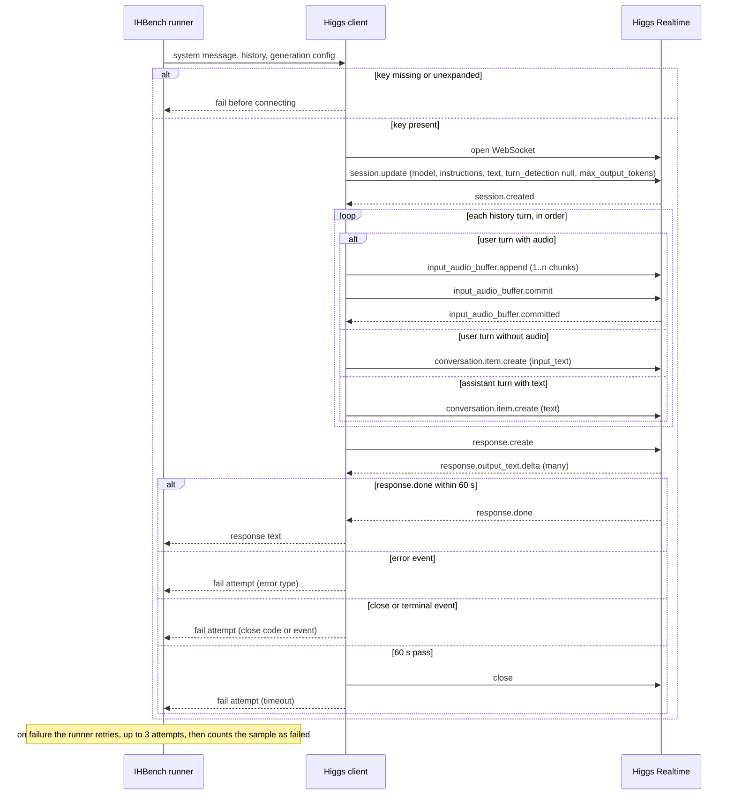
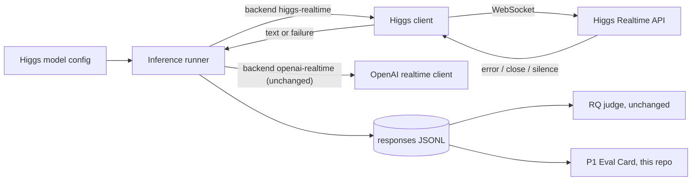

# Spec: IHBench client for Higgs Realtime
Spec ID: SPEC-2026-10-24-ihbench-higgs-client
Status: draft
Tier: Full SDD — scorecard 4/6 (raised by spec-creator from the main session's 3/6, Lightweight: Q2 became "yes" because a sample's multi-turn history can be replayed two ways)
Supersedes: none
Packages: the fork `../ihbench-higgs` of `boson-ai/ihbench`, branch `feat/higgs-realtime-client`, PR to `boson-ai/ihbench`. The spec lives in this repo. The code lives in the fork.
Design sources: user text, 2026-10-24: the brief for P0 (`docs/BRIEF.md`), the reuse map (`docs/reuse-map.md`, section "ihbench: how our client fits"), the friction log (`docs/FRICTION.md`), and Glib's answers of 2026-10-24 on runner edits, history replay, timeout, token cap, smoke size, concurrency and where the tests live. Boson facts are cited by id from `docs/boson-protocol.md`.

## Problem and user

IHBench is Boson's interruption-recovery benchmark. It cannot run against Boson's own Higgs Realtime API. Its OpenAI realtime client waits for an event Higgs does not send first (F1), sends user audio in a form Higgs skips and names assistant text in a form Higgs does not recognise (F3), and waits for an event Higgs never emits (F5). The user is two people: Boson's IHBench maintainers, who get a small reviewable PR that lets their benchmark score their own model, and us, because P1's Eval Card reads the responses file this client produces.

## Outcome and metrics

- Outcome: an IHBench run against Higgs Realtime produces one response row per sample, and the PR is open against `boson-ai/ihbench`.
- Metric 1: on the smoke subset (10 samples), rows written = 10, runner failures = 0, client-logged `error` events = 0 (AC-28 to AC-32).
- Metric 2: the PR changes three files: one new client, one new model config, and the runner's backend registration (AC-26).
- RQ scores computed from these responses are not a metric of this spec. Any RQ number that reaches a stage, the PR or the friction log needs a row in `docs/CLAIMS.md`.

## Goals / Non-goals

Goals
- Run IHBench samples against Higgs Realtime. Each user turn is replayed as audio and each assistant turn as text, in history order, so the setup matches the existing OpenAI realtime client and RQ results stay comparable with the paper (Glib, Q1).
- Respect the Higgs protocol as documented: F1, F3, F4, F5, F6, F14, F16, F20, plus the close and error behaviour in F13 and F21.
- Fail a sample loudly on any protocol error, close or timeout, so the runner's retry and failure accounting see it.
- Keep the PR small: a new client, a new model config, and the minimum runner edit (one backend choice, one dispatch branch). Glib's decision of 2026-10-24 is recorded in `docs/reuse-map.md`.
- Keep the existing OpenAI realtime client's behaviour unchanged.

Non-goals
- Changing the benchmark, the dataset, the judge or the evaluation script.
- A generic registry for API backends. It is proposed in the PR description only (FRICTION.md row "two files, zero runner edits").
- Audio output, voices (F7), tools (F10) and server VAD. The client is text-out and drives turns manually.
- A configurable endpoint. The client connects to the endpoint in F1.
- Cost accounting per sample. Docs and wire disagree on whether `response.done` carries usage (F2), and the benchmark's row format has no field for it.
- Offline tests inside the PR. They live on a separate branch of the fork, and the PR description offers them to the maintainers (Glib, Q6).
- Raising `max_workers` above 1 before the concurrency limit (F21) is known.

## User stories

- As an IHBench maintainer, I run the documented inference command with the Higgs model config and get a responses file I can judge like any other model's.
- As a reviewer of the PR, I see three changed files, and the runner change is one backend choice plus one dispatch branch.
- As the P1 Eval Card, I read a responses file whose rows all came from runs with no protocol error.

## Acceptance criteria (EARS)

Session start
- AC-1 WHEN the client opens a session for a sample, the system shall send `session.update` as its first message, without waiting for any server event (F1). — proof: red-first unit — verify: a fake server that stays silent until it receives a message; run one sample; expect the first client message to be `session.update`.
- AC-2 The system shall name the model `higgs-realtime` and put the sample's system message in `instructions` in the first `session.update` (F1, F20). — proof: red-first unit — verify: capture the first `session.update` for a sample with system message "S"; expect model `higgs-realtime` and instructions "S".
- AC-3 The system shall request text-only output with `output_modalities` `["text"]` in the first `session.update` (F6). — proof: red-first unit — verify: capture the first `session.update`; expect exactly `["text"]`.
- AC-4 The system shall set `turn_detection` to null in the first `session.update` (F16). — proof: red-first unit — verify: capture the first `session.update`; expect `turn_detection` present and null.
- AC-5 The system shall set the session's `max_output_tokens` to the run's `max_new_tokens` (F20). — proof: red-first unit — verify: run with `max_new_tokens` 4096; expect `max_output_tokens` 4096 in the first `session.update`.
- AC-6 WHEN `session.created` arrives after the first `session.update`, the system shall start replaying the history without waiting for `session.updated` (F14). — proof: red-first unit — verify: a fake server that answers the first update with `session.created` only; expect history items to follow.

History replay
- AC-7 The system shall never send audio inside `conversation.item.create` (F3). — proof: red-first unit — verify: replay a history with three audio user turns; expect zero `conversation.item.create` events carrying audio content.
- AC-8 WHEN replaying a user turn that has a WAV, the system shall send its audio as one or more `input_audio_buffer.append` events of at most 1 MiB of base64 each, followed by exactly one `input_audio_buffer.commit` (F4, F16). — proof: red-first unit — verify: a 40 s WAV turn; expect at least two appends, each payload ≤ 1,048,576 base64 characters, then one commit.
- AC-9 The system shall send user audio as 24 kHz, 16-bit, mono PCM, whatever the source WAV's rate and channel count (F4). — proof: red-first unit — verify: a 2.0 s, 16 kHz stereo WAV; expect the decoded appended bytes to total 2.0 × 24000 × 2 bytes, within one frame.
- AC-10 WHEN replaying a user turn that has no WAV, the system shall add it as a user item with `input_text` content holding the turn's text (F3). — proof: red-first unit — verify: a history whose first user turn has no audio file; expect one user `input_text` item with that text and no append for it.
- AC-11 WHEN replaying an assistant turn with non-empty text, the system shall add it as an assistant item whose content type is `text` (F3). — proof: red-first unit — verify: an assistant turn "Sure, the"; expect one assistant item with content type `text` and that text, and no `output_text` anywhere.
- AC-12 IF an assistant turn's text is empty, THEN the system shall send nothing for that turn. — proof: red-first unit — verify: an assistant turn with empty text; expect no item for it.
- AC-13 WHILE replaying the history, the system shall send items in the sample's history order and shall not send the next item until `input_audio_buffer.committed` has arrived for the preceding user audio commit (F16). — proof: red-first unit — verify: a fake server that delays `committed` by 200 ms; expect the next history event only after it.
- AC-14 WHEN a live replay of a sample with at least two user audio turns completes, the system shall have built a server-side conversation whose order matches the history order, as shown by the `previous_item_id` of each `input_audio_buffer.committed` event (F16). [NEEDS CLARIFICATION: how the server id of a text item added with `conversation.item.create` becomes observable to the client; no acknowledgement of that item is listed in `docs/boson-protocol.md`] — proof: e2e — verify: live run of one multi-turn sample with event logging on; expect every `previous_item_id` to point at the item replayed just before.
- AC-15 The system shall not wait for `conversation.item.done` at any point (F5). — proof: red-first unit — verify: a fake server that never sends `conversation.item.done`; expect the sample to finish with a response.

Response
- AC-16 WHEN the last history item has been replayed, the system shall send exactly one `response.create` (F16). — proof: red-first unit — verify: replay a 5-item history; expect one `response.create`, sent after the last history event.
- AC-17 WHEN `response.done` arrives for that response, the system shall return the concatenated text of its `response.output_text.delta` events as the sample's response (F6, F17). — proof: red-first unit — verify: a fake server streaming deltas "Of", "ten", "!" then `response.done`; expect "Often!".
- AC-18 IF the server sends an event type the client does not handle, THEN the system shall ignore it and continue the sample (F5). — proof: red-first unit — verify: inject `conversation.context.summarized` and a made-up type mid-stream; expect the same returned text as without them.

Failure handling
- AC-19 IF an `error` event arrives at any point in a sample, THEN the system shall fail that attempt with an error naming the error type, and log one line for the event. — proof: red-first unit — verify: a fake server that sends `error` type `voice_output_task_ongoing` after `response.create`; expect the attempt to raise, and one logged line naming that type.
- AC-20 IF the connection closes before `response.done`, THEN the system shall fail that attempt with an error naming the close code, or the terminal event that preceded the close, and log one line for the failed attempt (F5, F8, F13, F21). — proof: red-first unit — verify: four runs where the fake server closes with 4429, 3000 and 1013, and once after `session.idle_timeout`; expect each attempt to raise, naming that code or event, with one logged line each.
- AC-21 IF `response.done` has not arrived within 60 s of the attempt opening its connection, THEN the system shall close the connection, fail that attempt, and log one line for the timeout. — proof: red-first unit — verify: a fake server that never sends `response.done`, on a controllable clock; expect a failure at 60 s, a closed connection and one logged timeout line.
- AC-22 IF the API key is missing, empty, or still the unexpanded placeholder `${BOSON_API_KEY}`, THEN the system shall fail before opening any connection, with a message that names `BOSON_API_KEY`. — proof: red-first unit — verify: three runs (unset, empty, literal placeholder) against a fake server; expect each to fail with zero connection attempts and a message containing "BOSON_API_KEY".
- AC-23 The system shall never write the API key into a log line, an error message or a response row. — proof: red-first unit — verify: run the AC-19, AC-20 and AC-21 failure paths with a sentinel key; expect the sentinel in none of the captured output.

Runner and config (PR footprint)
- AC-24 WHEN the inference runner is started with backend `higgs-realtime`, the system shall run samples through the Higgs client, using the run's model and API key. — proof: red-first unit — verify: start the runner's client construction with backend `higgs-realtime`; expect a Higgs client carrying the given model and key.
- AC-25 WHEN the inference runner is started with backend `openai-realtime`, the system shall build the existing OpenAI realtime client with the same arguments as before this change. — proof: red-first unit — verify: build with backend `openai-realtime` on the PR branch and on upstream main; expect the same client type and the same constructor arguments.
- AC-26 The PR shall change exactly three files: a new Higgs client, a new `configs/higgs-realtime.yaml`, and the inference runner. In the runner, the only existing line that changes is the backend-choices line, which gains `higgs-realtime`, and the only other change is one added dispatch branch. The runner's module docstring stays as it is. — proof: e2e — verify: list the PR's changed files and read the runner diff; expect three files, one modified line (the choices line) and one added branch, and nothing else.
- AC-27 The `configs/higgs-realtime.yaml` model config shall set backend `higgs-realtime`, model `higgs-realtime`, the API key from `${BOSON_API_KEY}`, `max_new_tokens` 4096 and `max_workers` 1. — proof: red-first unit — verify: load the config; expect those five values.

Smoke run (P0 done-condition)
- AC-28 WHEN the runner runs with `configs/higgs-realtime.yaml`, `--limit 10` and `--output responses/higgs-realtime.jsonl`, the system shall write exactly 10 rows to that file. — proof: e2e — verify: live run; count the lines in the output file; expect 10.
- AC-29 WHEN the AC-28 smoke run completes, the system shall have written every row with the runner's keys `sample_id`, `conversation_id`, `interruption_type`, `turn_depth` and `response`. — proof: e2e — verify: parse each line; expect all five keys present in all 10 rows.
- AC-30 WHEN the AC-28 smoke run completes, the system shall have written a `response` that is non-empty after trimming whitespace, in every row. — proof: e2e — verify: parse each line; expect 10 non-empty responses.
- AC-31 WHEN the AC-28 smoke run completes, the runner shall report 10 responses saved and 0 failures. — proof: e2e — verify: the runner's final stderr line reads "10 responses saved to responses/higgs-realtime.jsonl, 0 failures."
- AC-32 WHEN the AC-28 smoke run completes, the run log shall contain zero failed-attempt lines (AC-19, AC-20, AC-21), including those from attempts the runner retried. — proof: e2e — verify: search the captured stderr of the run for the AC-19, AC-20 and AC-21 log lines; expect zero matches.
- AC-33 The system shall never send a `system`-role conversation item (F3). — proof: red-first unit — verify: run a sample with a non-empty system message; expect zero items with role `system` among the client's messages.

## Requirements coverage

| R | requirement | source | AC |
|---|---|---|---|
| R-1 | The smoke subset produces a response row per sample with no protocol errors | brief (BRIEF.md P0) | AC-28, AC-29, AC-30, AC-31, AC-32 |
| R-2 | User audio streams through `input_audio_buffer.append` (≤ 1 MiB) plus commit, never as `conversation.item.create` audio | brief; F3, F4 | AC-7, AC-8, AC-9 |
| R-3 | No waiting for `session.created` before `session.update` | brief; F1 | AC-1, AC-6 |
| R-4 | No waiting for `conversation.item.done` | brief; F5 | AC-15 |
| R-5 | Assistant history items use `text` | brief; F3 | AC-11, AC-12 |
| R-6 | Every user turn as audio, assistant turns as text, in history order, `turn_detection` null | Glib, Q1 | AC-4, AC-10, AC-13, AC-14, AC-16 |
| R-7 | Text output, as the benchmark contract returns text | brief; F6 | AC-3, AC-17 |
| R-8 | The system message reaches the model | brief (benchmark contract); F3, F20 | AC-2, AC-33 |
| R-9 | 60 s per sample attempt, then failure and runner retry | Glib, Q2 | AC-21 |
| R-10 | `max_new_tokens` becomes the session's `max_output_tokens` | Glib, Q3 | AC-5 |
| R-11 | Smoke subset is N = 10 | Glib, Q4 | AC-28, AC-31 |
| R-12 | `max_workers` 1 for Higgs | Glib, Q5 | AC-27 |
| R-13 | PR = new client + YAML + one backend choice and one dispatch branch, small and reviewable | Glib, runner-edit answer; reuse-map | AC-24, AC-26, AC-27 |
| R-14 | The existing OpenAI realtime client keeps working unchanged | brief | AC-25, AC-26 |
| R-15 | Protocol errors, closes and unknown events are handled per the documented protocol | F5, F13, F14, F21 | AC-18, AC-19, AC-20, AC-32 |
| R-16 | A missing or unexpanded key fails before connecting | accepted proposal, 2026-10-24 | AC-22, AC-23 |
| R-17 | Smoke responses are non-empty | accepted proposal, 2026-10-24 | AC-30 |

## Edge cases

- A user WAV longer than about 15 s exceeds one append (F4). It is split into several appends before a single commit (AC-8).
- A user turn whose audio file is missing is replayed as text (AC-10), as in the existing client.
- A user turn whose WAV decodes to zero samples. [NEEDS CLARIFICATION: replay it as `input_text`, or commit an empty buffer? F16 does not say whether an empty commit is accepted]
- An interrupted assistant turn arrives already truncated by the dataset loader. It is replayed as given, never restored to the full utterance.
- An empty assistant turn sends nothing (AC-12).
- A history that starts with an assistant turn is replayed in order like any other.
- Live replay order differs from history order (AC-14 fails). This is an implementer blocker. The spec is updated to "prior user turns as text, interrupting turn as audio" (Q1 option b), and the plan is re-reviewed. The code does not fall back silently.
- `max_new_tokens` above 4096 is clamped by the server (F20). The client sends the configured value unchanged.
- The server's 5-minute idle close (F8) may not apply with `turn_detection` null (UNVERIFIED in `docs/boson-protocol.md`). The 60 s attempt bound (AC-21) holds either way.
- Exceeding the concurrency limit closes with 1013 (F21). That is a failed attempt (AC-20), and the runner retries.
- An attempt that fails and then succeeds on the runner's retry still writes a row. AC-32 catches the hidden failure.
- With `--limit 10`, the runner takes the first 10 samples in dataset order, which may come from only one or two conversations. [NEEDS CLARIFICATION: is "first 10 samples" an acceptable smoke subset, or should the subset be chosen to cover several interruption types? Accepting "first 10" needs no runner change]

## Non-functional requirements

- Performance: one sample attempt ends within 60 s (AC-21). The runner's three attempts bound a sample at about 3 minutes plus backoff.
- Cost: the smoke run is 10 samples, sequential (AC-27, AC-28). Output is capped per response by `max_output_tokens` (AC-5). The client does not rely on per-response usage, since docs and wire disagree on it (F2). Any cost figure shown anywhere is computed from F12 and gets a `docs/CLAIMS.md` row. No new LLM call beyond the model under test.
- Security and privacy: the API key comes from the environment, is checked before connecting (AC-22) and never appears in output (AC-23). Model output is untrusted and flows into the judge's prompt (see Untrusted inputs). No user data beyond the public dataset is sent.
- Accessibility: none beyond existing (no UI).
- i18n: none beyond existing.
- Reliability: every protocol error, early close or timeout fails the attempt (AC-19 to AC-21), so the runner's existing retry handles it. A partial text is never returned as a success. Concurrency stays at 1 until the F21 limit is known.

## Workflows and module communication

One sample attempt, including what happens when the server errors, closes or goes silent. The client never waits for `session.updated` or `conversation.item.done`.

Who calls whom across the PR boundary:

## Contracts

- Runner backend value: `higgs-realtime`, added to the existing list. No existing value changes meaning.
- Model config `configs/higgs-realtime.yaml`: the keys the runner already reads (`backend`, `model`, `api_key`, `max_new_tokens`, `max_workers`), with the values in AC-27. No new keys.
- Client contract: the same as every IHBench model client. Inputs are a system message, an ordered history of user (audio or text) and assistant (text) turns, and a generation config. The output is the assistant's text, or a raised failure. A failure never comes back as an empty or partial string.
- Responses file: unchanged runner format. One JSON object per line with `sample_id`, `conversation_id`, `interruption_type`, `turn_depth`, `response`. This repo consumes it read-only.
- Wire protocol: as cited (F1, F3, F4, F5, F6, F13, F14, F16, F17, F20, F21). The spec never restates a fact.

## Inputs and provenance

- System message, history turns and sample metadata [reused: IHBench dataset `bosonai/ihbench`, through the existing loader]
- User turn audio, as WAV files [reused: IHBench dataset audio cache]
- Audio as 24 kHz PCM16 mono [deterministic: client-side audio conversion]
- `max_new_tokens`, `max_workers`, model, key placeholder [reused: model config plus runner arguments]
- API key [reused: environment `BOSON_API_KEY`]
- Assistant response text [new: 1 LLM call per sample attempt, the model under test (Higgs Realtime)]

## Untrusted inputs

- Dataset transcripts and audio, downloaded from Hugging Face. They are sent to the model as data only. They never pick an endpoint, a file path outside the audio cache, or a session field other than content.
- Server events. Unknown types are ignored (AC-18). Error payloads and close reasons are logged by type or code, never executed or used to choose behaviour beyond failing the attempt.
- Model output. It is written verbatim into the responses file and later placed in the RQ judge's prompt, so it is a prompt-injection path into the judge. The client neither interprets nor alters it. Judge hardening is out of scope (upstream judge, unchanged), and the risk goes into the PR description.
- Config values after environment expansion, notably the key: validated before use (AC-22) and never echoed (AC-23).

## Open questions

- [NEEDS CLARIFICATION: how the server id of a text item added with `conversation.item.create` becomes observable to the client, so AC-14 can check the full order and not only audio items] — non-blocking (AC-14; a live run can answer it)
- [NEEDS CLARIFICATION: a user turn whose WAV decodes to zero samples: replay as `input_text` or commit an empty buffer] — non-blocking (edge case; proposal: replay as `input_text`)
- [NEEDS CLARIFICATION: is "first 10 samples in dataset order" an acceptable smoke subset, or must it span several interruption types] — non-blocking (AC-28; proposal: first 10, no runner change)
- [NEEDS CLARIFICATION: pass the run's `temperature` (runner default 1.0) to the session, or leave the Higgs default (F20) as the OpenAI realtime client leaves its own] — non-blocking (one detail; proposal: leave the default, for parity)

## Traceability

| AC | proof | verify | step | test | commit |
|---|---|---|---|---|---|
| AC-1 | red-first unit | silent fake server; first client message is `session.update` | — | — | — |
| AC-2 | red-first unit | first update has model `higgs-realtime`, instructions = system message | — | — | — |
| AC-3 | red-first unit | first update `output_modalities` exactly `["text"]` | — | — | — |
| AC-4 | red-first unit | first update `turn_detection` present and null | — | — | — |
| AC-5 | red-first unit | `max_new_tokens` 4096 becomes `max_output_tokens` 4096 | — | — | — |
| AC-6 | red-first unit | only `session.created` sent; replay starts | — | — | — |
| AC-7 | red-first unit | three audio turns; no audio in any item create | — | — | — |
| AC-8 | red-first unit | 40 s WAV; ≥ 2 appends ≤ 1 MiB each, one commit | — | — | — |
| AC-9 | red-first unit | 2.0 s 16 kHz stereo WAV becomes 96,000 bytes ± 1 frame | — | — | — |
| AC-10 | red-first unit | user turn without audio becomes one `input_text` item | — | — | — |
| AC-11 | red-first unit | assistant turn becomes a `text` item; no `output_text` | — | — | — |
| AC-12 | red-first unit | empty assistant turn sends nothing | — | — | — |
| AC-13 | red-first unit | `committed` delayed 200 ms; next item waits | — | — | — |
| AC-14 | e2e | live multi-turn sample; `previous_item_id` chain matches history | — | — | — |
| AC-15 | red-first unit | no `conversation.item.done` ever; sample completes | — | — | — |
| AC-16 | red-first unit | 5-item history; one `response.create` after the last item | — | — | — |
| AC-17 | red-first unit | deltas "Of","ten","!" return "Often!" | — | — | — |
| AC-18 | red-first unit | unknown events injected; same text returned | — | — | — |
| AC-19 | red-first unit | `error` event fails the attempt; one log line with its type | — | — | — |
| AC-20 | red-first unit | closes 4429 / 3000 / 1013 / after idle timeout each fail, naming the cause, one log line each | — | — | — |
| AC-21 | red-first unit | no `response.done`; failure, close and one log line at 60 s | — | — | — |
| AC-22 | red-first unit | unset / empty / placeholder key; zero connections, message names `BOSON_API_KEY` | — | — | — |
| AC-23 | red-first unit | sentinel key absent from all failure output | — | — | — |
| AC-24 | red-first unit | backend `higgs-realtime` builds the Higgs client with model and key | — | — | — |
| AC-25 | red-first unit | backend `openai-realtime` builds the same client and args as upstream main | — | — | — |
| AC-26 | e2e | PR file list = 3 files; runner diff = choices line modified + one added branch, docstring untouched | — | — | — |
| AC-27 | red-first unit | config has the five values | — | — | — |
| AC-28 | e2e | live `--limit 10`; output has 10 lines | — | — | — |
| AC-29 | e2e | all 10 rows carry the five keys | — | — | — |
| AC-30 | e2e | all 10 responses non-empty after trim | — | — | — |
| AC-31 | e2e | final line "10 responses saved …, 0 failures." | — | — | — |
| AC-32 | e2e | zero AC-19/20/21 failed-attempt lines in the run's stderr | — | — | — |
| AC-33 | red-first unit | non-empty system message; zero `system`-role items sent | — | — | — |

The red-first unit tests run against a fake WebSocket server and live on a separate branch of the fork, not in the PR (Glib, Q6). The e2e checks need `BOSON_API_KEY` and spend credits.

## Changelog

| date | change | why |
|---|---|---|
| 2026-10-24 | Spec created as draft, Full SDD 4/6 (create plus answers mode). | P0 of `docs/BRIEF.md`. Glib answered Q1–Q6 and the runner-edit question, and research added F14, F16, F20 and F21. After the live smoke the F2 wording was aligned (docs and wire disagree on usage). F1, F5 and F14 are now VERIFIED-RUN; ids unchanged. |
